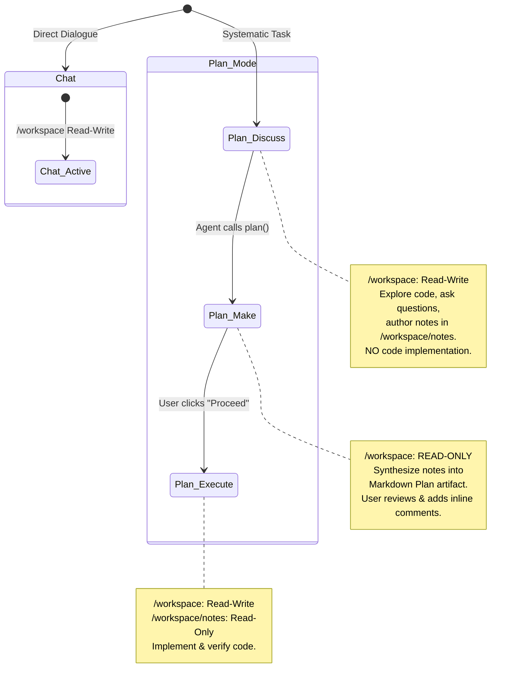

# Seamus: Features & Capabilities

> **A deep agent harness that I fully own and can customize.**

Seamus is an open, self-hosted, deep agent execution harness and developer workspace. Engineered from the ground up for total developer ownership, Seamus frees you from opaque cloud agent silos, proprietary platforms, and insecure local scripts. Every component—from multi-container sandbox execution and Git-native checkpoint persistence to interactive adaptive UI surfaces and zero-leak secrets management—is transparent, inspectable, and under your absolute control.

---

## Table of Contents

1. [At a Glance](#at-a-glance)
   - [Why Seamus? The Value Proposition](#why-seamus-the-value-proposition)
   - [Architectural Highlights](#architectural-highlights)
   - [Competitive Matrix](#competitive-matrix)
2. [Deep-Dive Feature Breakdown](#deep-dive-feature-breakdown)
   - [1. Agent, Session & Thread Architecture](#1-agent-session--thread-architecture)
   - [2. Multi-Container Execution & Filesystem Sandboxing](#2-multi-container-execution--filesystem-sandboxing)
   - [3. Git-Native Persistence, Checkpointing & Provenance](#3-git-native-persistence-checkpointing--provenance)
   - [4. Operational Modes & Structured Plan Lifecycle](#4-operational-modes--structured-plan-lifecycle)
   - [5. Adaptive UI (A2UI v0.9) & Dynamic Artifacts](#5-adaptive-ui-a2ui-v09--dynamic-artifacts)
   - [6. Anthropic Skills System & Precedence Engine](#6-anthropic-skills-system--precedence-engine)
   - [7. Enterprise Secrets Vault (OpenBao KV v2)](#7-enterprise-secrets-vault-openbao-kv-v2)
   - [8. Developer Web UI & Workspace Ergonomics](#8-developer-web-ui--workspace-ergonomics)
   - [9. DeepAgent Runtime Introspection & Inspector](#9-deepagent-runtime-introspection--inspector)
   - [10. Telemetry & Observability (Pydantic Logfire & OpenTelemetry)](#10-telemetry--observability-pydantic-logfire--opentelemetry)
   - [11. 1-Click Zero-Friction Stack Launch](#11-1-click-zero-friction-stack-launch)
3. [Every Goddamn Flag (Exhaustive Configuration & Reference Manual)](#every-goddamn-flag-exhaustive-configuration--reference-manual)
   - [CLI Flags & Scripts (`run.sh`)](#cli-flags--scripts-runsh)
   - [Complete Environment Variables Reference](#complete-environment-variables-reference)
   - [Agent & Inference Configuration Schema (`AgentConfig` & `InferenceConfig`)](#agent--inference-configuration-schema-agentconfig--inferenceconfig)
   - [System Settings Schema (`SystemSettings`)](#system-settings-schema-systemsettings)
   - [Docker Compose Topology, Ports & Volumes](#docker-compose-topology-ports--volumes)
   - [Sandbox Filesystem Mount Paths](#sandbox-filesystem-mount-paths)
   - [Harness Tools Palette & Lifecycle Transitions](#harness-tools-palette--lifecycle-transitions)
   - [REST API Endpoints Reference (`/api/v-alpha/`)](#rest-api-endpoints-reference-apiv-alpha)

---

## At a Glance

### Why Seamus? The Value Proposition

| Core Problem in Modern AI Agents | The Seamus Solution |
| :--- | :--- |
| **Black-box hosted agent clouds** lock your data, prompt techniques, and agent workflows inside proprietary vendor platforms. | **100% self-hosted & developer-owned.** Run on your own Linux machine or private cluster. Full source access across the entire stack. |
| **Unsafe local execution** lets agents run arbitrary bash commands and mutate files directly on your workstation. | **Heavyweight container sandboxing (OpenSandbox + Docker).** Agents execute strictly inside isolated disposable Linux containers with granular read-write/read-only mount policies. |
| **Volatile, ephemeral memory** that vanishes on crash, with no audit trail or rollback capability. | **Git-native persistence (Gitea + GitCheckpointSaver).** Every turn, tool call, checkpoint, and file mutation is an immutable Git commit with branches, commit logs, and Sync Pull Requests. |
| **Uncontrolled runaway coding loops** where agents start editing critical code before understanding the task or architecture. | **Rigorous three-phase Plan Mode (`discuss` &rarr; `make` &rarr; `execute`).** Enforces exploration, notes authoring, read-only plan synthesis, and explicit human-in-the-loop review before code mutation. |
| **Flat, unformatted text chat** incapable of collecting structured answers or presenting interactive forms. | **Adaptive UI (A2UI v0.9).** Agents render interactive questionnaires that block until answered, tabbed configuration forms, and dedicated Plan tabs with inline section comments and Proceed gates. |
| **Leaked API keys and plaintext secrets** committed to git repositories, logged in traces, or saved in disk files. | **Integrated OpenBao Secrets Vault (KV v2).** Symbolic `${secret('/path')}` references, strictly in-memory resolution, zero disk secrets, and version-pinned snapshotting in checkpoint commits. |
| **Static, rigid agent configurations** that cannot be extended with modular capabilities. | **Anthropic Skills Standard (`SKILL.md`).** Drop in modular skills with a multi-tiered priority engine spanning bundled, session, background, and system directories. |
| **Opaque reasoning and invisible prompts** making it impossible to debug hallucinations or bad tool calls. | **DeepAgent Inspector.** Deconstructs composite LM-XML system prompts into layered cards, exposes registered JSON tool schemas, tracks active todos, and surfaces live diffs. |

### Architectural Highlights

```
+------------------------------------------------------------------------------------+
|                                    React 19 SPA                                    |
|   [Hierarchical Sidebar] <---> [Multi-Thread Chat & A2UI] <---> [Changes Diff Tab] |
|   [DeepAgent Inspector]  <---> [In-Browser Modal & Raw JSON Config Editor]         |
+------------------------------------------------------------------------------------+
                                         │ (HTTP REST & Real-Time SSE Streams)
                                         ▼
+------------------------------------------------------------------------------------+
|                                 FastAPI Backend                                    |
|   • Singleton ConfigTemplate & SystemSettingsStore                                 |
|   • SessionAgentRunner (DeepAgent Runtime + ReasoningChatOpenAI)                   |
|   • OpenBao Secrets Vault Client & Symbolic Expression Interpolator                |
|   • AG-UI Event Broadcaster (Pub-Sub & History Replay)                            |
|   • DynamicSystemPromptMiddleware (Structured LM-XML Scaffold)                     |
+------------------------------------------------------------------------------------+
                   │                                             │
                   ▼                                             ▼
+-------------------------------------+       +--------------------------------------+
|       OpenSandbox Execution         |       |      Git Persistence & State         |
|  • Containerized execution sandbox  |       |  • Gitea Git Server (Port 3001)      |
|  • Mounts /workspace (data/)        |       |  • Repository per Agent (agent-{id}) |
|  • Mounts /artifacts (read-only)    |       |  • Branch per Session (session/{id}) |
|  • Mounts /skills/bundled (ro)      |       |  • Automated GitCheckpointSaver      |
|  • Mounts system skills (ro)        |       |  • Automated Sync PR Lifecycle       |
|  • Dynamic mode mount policies      |       |  • Zero database in harness backend  |
+-------------------------------------+       +--------------------------------------+
                   │                                             │
                   ▼                                             ▼
+-------------------------------------+       +--------------------------------------+
|          OpenBao Secrets            |       |         Observability Stack          |
|  • OpenBao KV v2 Engine             |       |  • Pydantic Logfire Tracing          |
|  • Token & Key Management           |       |  • OpenTelemetry Native Exporters    |
|  • Version-pinned snapshots         |       |  • Sensitive Credential Scrubbing    |
+-------------------------------------+       +--------------------------------------+
```

### Competitive Matrix

| Feature | Generic Python Frameworks (LangChain vanilla, CrewAI, AutoGen) | Cloud Coding Agents (Cursor, Claude Code, Windsurf) | Seamus Deep Agent Harness |
| :--- | :---: | :---: | :---: |
| **Self-Hosted Ownership** | Partial (requires custom wiring) | No (Vendor Cloud) | **Yes (100% owned & self-hosted)** |
| **Execution Sandboxing** | None (runs directly on host) | Local Process / Cloud VM | **Docker Container (OpenSandbox)** |
| **Persistence Engine** | SQLite / Vector DB / In-memory | Proprietary Cloud DB | **Native Git Repository (Gitea)** |
| **State Rollback & Audit** | Difficult / Manual | Opaque Cloud History | **Git Commits & Branch Provenance** |
| **Workflow Discipline** | Single loop / Freeform | Uncontrolled coding loop | **Phased Plan Mode (`discuss` &rarr; `make` &rarr; `execute`)** |
| **Interactive UI Artifacts** | Text only | Basic diff views | **A2UI v0.9 (Questionnaires, Forms, Plans)** |
| **Secrets Management** | Plaintext `.env` files | Proprietary Cloud Vault | **OpenBao KV v2 + Symbolic References** |
| **Skill Extensibility** | Custom python functions | Proprietary extensions | **Anthropic Skills Standard (`SKILL.md`)** |
| **Inspection & Debugging** | Print statements / loggers | Minimal | **DeepAgent Inspector + LM-XML Prompts** |
| **One-Click Local Launch** | Multi-step manual setup | N/A (Desktop app) | **Automated `./run.sh` Stack Orchestration** |

---

## Deep-Dive Feature Breakdown

### 1. Agent, Session & Thread Architecture

Seamus organizes work into a clean three-tiered entity hierarchy:

- **Agent**: An autonomous software identity configured with a baseline **Persona** (such as `Coder`), inference configuration, custom system prompts, and tools. Each agent owns a dedicated Git repository (`agent-{agent_id}`) on Gitea.
- **Session (Conversation)**: An isolated operational task and conversational context. A session clones its parent agent's configuration and creates an isolated Git branch (`session/{session_id}`). Sessions support full lifecycle states (`ACTIVE`, `KILLED`, `FAILED`) and **Session Branching**, allowing you to fork a new child session from any historical assistant turn with commit-level provenance.
- **Thread**: A sequential execution segment within a session representing a discrete operational mode or plan phase. Only the most recent thread in a session is open; earlier threads are sealed. Mode switches automatically close the active thread and spawn a fresh thread, reusing empty threads to eliminate clutter.
- **Dual Identifier Resolution**: Every Agent, Session, and Thread can be addressed by its canonical UUID or by an ergonomic, human-readable, URL-safe slug (e.g. `agent/frontend-bot/session/auth-refactor/thread/discuss-requirements`).

### 2. Multi-Container Execution & Filesystem Sandboxing

Never trust an LLM to run arbitrary commands on your host workstation. Seamus delegates all execution to **OpenSandbox**:

- **Strict Container Isolation**: Agents execute inside containerized Linux environments (default `python:3.12-slim`, fully customizable). Commands outside the sandbox cannot touch host files or networks.
- **Sandboxed Operational Directory (`/workspace`)**: The agent's persistent workspace is mounted at `/workspace`, mapped directly to the session's Git-tracked `data/` directory. Files created or modified inside `/workspace` are tracked, committed, and version-controlled. Everything outside `/workspace` inside the container is transient.
- **Dynamic Mount Policies**: Mount permissions adapt dynamically according to the active mode and plan phase:
  - In `chat` and `plan/discuss`: `/workspace` is mounted read-write.
  - In `plan/make`: `/workspace` is mounted strictly **read-only**, preventing unauthorized code mutations while authoring the plan.
  - In `plan/execute`: `/workspace` is read-write, while `/workspace/notes` is mounted read-only to safeguard historical research.
- **Per-Command Timeouts & TTL**: Configurable per-command execution timeout (default: 300s) and container lifetime TTL (default: 3600s).

### 3. Git-Native Persistence, Checkpointing & Provenance

Seamus eliminates complex relational databases for harness state. Gitea is the single source of truth:

- **Automated Checkpoint Commits**: Whenever the LangGraph checkpointer saves state, Seamus commits all new, modified, or deleted files under `data/` and `agent/state/` with commit prefix `checkpoint:`. Turn completions commit with prefix `state:`.
- **Stateless Harness Hydration**: On server startup, Seamus queries Gitea's API and reconstructs all in-memory agents, sessions, and threads directly from Git branches. No SQL database migrations or lost state.
- **Gitea Sync Pull Requests**: Upon session creation, an automated Sync PR is opened from `session/{session_id}` targeting `main`. The PR status and live deliverable diff are tracked in real-time.
- **Atomic Thread Acceptance**: Clicking "Accept" in the top bar merges the session's deliverables into `main`, closes the active thread, spawns a fresh thread, and opens a renewed Sync PR.
- **Deliverable Isolation**: Git commits strictly distinguish between agent state metadata (`agent/config/`, `agent/state/`) and actual code deliverables (`data/`). Sync PR merges exclusively target `data/`.

### 4. Operational Modes & Structured Plan Lifecycle

Prevent premature code churn with Seamus's opinionated operational mode engine:



- **Chat Mode (`chat`)**: Unconstrained conversational dialogue and immediate code editing. Useful for quick fixes, queries, and interactive debugging.
- **Plan Mode (`plan`)**: A structured three-phase pipeline:
  1. **Discuss (`plan/discuss`)**: The agent reads the codebase, gathers requirements, interviews the user via blocking questionnaires (`make_questionnaire`) or non-blocking forms (`make_form`), and records architectural findings in `/workspace/notes`. Code modification is strictly forbidden. When ready, the agent calls `plan()` to advance to Make.
  2. **Make (`plan/make`)**: The workspace is locked to **read-only**. The agent authors and refines the session's Markdown Plan artifact via `make_plan`. The user reviews the rendered plan in a dedicated UI tab, adds section-level comments, and clicks **Proceed** to authorize execution.
  3. **Execute (`plan/execute`)**: With the plan approved, the workspace is unlocked to read-write (with `/workspace/notes` preserved as read-only). The agent implements and verifies the deliverables.
- **Escape Hatch (`discard()`)**: The user or agent can abort the plan workflow at any time, cleaning up active plan artifacts.

### 5. Adaptive UI (A2UI v0.9) & Dynamic Artifacts

Move beyond text chat. Seamus implements the open **A2UI (Adaptive Agent User Interface) v0.9** standard to render dynamic, interactive components directly in the browser:

- **Direct Filesystem Persistence**: Artifacts are stored under `<session_workspace>/artifacts/<family>/<uuid>/`, capturing `manifest.json`, `body.json`, `state.json`, and per-button evaluated interaction files.
- **Embedded Questionnaires (`make_questionnaire`)**: Rendered directly in the chat stream with `blocking=true`. The agent calls `wait_for_click`, pausing execution until the user selects chips, radio options, or fills in text inputs.
- **Tabbed Forms (`make_form`)**: Non-blocking forms rendered in dedicated workspace tabs for complex configuration input while the agent continues background tasks.
- **Interactive Implementation Plans (`make_plan`)**: Markdown-rendered plan artifacts with section-level inline commenting, approval indicators, and the interactive **Proceed** action.
- **Auto-Repair & Normalization**: The harness includes automatic component tree normalization (`normalize_a2ui_components`), button declaration auto-synthesis, pre-render surface validation, and structural warning checks to ensure invalid LLM UI JSON never breaks the frontend.

### 6. Anthropic Skills System & Precedence Engine

Extend your agents using the open [Anthropic Agent Skills standard](https://docs.langchain.com/oss/python/deepagents/skills). Skills are self-contained directories with a `SKILL.md` file featuring YAML frontmatter:

- **Multi-Tiered Precedence Engine**: Skills are resolved through a deterministic hierarchy where higher tiers override lower tiers on naming collisions:
  1. **Bundled Platform Skills** (`/skills/bundled`): Core harness capabilities built directly into Seamus (Highest Priority).
  2. **Visible Session Skills** (`/workspace/skills`): Git-tracked skills inside the session repository.
  3. **Background Session Skills** (`/workspace/.skills`): Hidden, Git-tracked project skills.
  4. **Auxiliary Project Skills** (`/projects/<repo>/skills` and `.skills`): External repository skills.
  5. **System-Wide Host Skills** (`/skills/system/{idx}`): Host directories configured via system settings (mounted read-only).
- **In-Sandbox Mounts**: All skills are mounted into the OpenSandbox container, enabling the agent to read instructions and execute companion scripts safely.

### 7. Enterprise Secrets Vault (OpenBao KV v2)

No more API keys leaked in git commits or environment logs:

- **OpenBao KV v2 Integration**: Native integration with OpenBao (the open-source, community-driven Vault fork) backed by PostgreSQL.
- **Symbolic Secret References**: Configurations use symbolic expressions rather than raw tokens:
  - `${secret('/api-key/inference/openrouter')}`
  - `${secret(path='/api-key/custom', field='token')}`
- **Zero Cleartext on Disk or in Git**: Secret references are resolved strictly in-memory during inference. Files written to disk or pushed to Gitea repositories never contain cleartext secrets.
- **Version-Pinned Exploded Snapshots**: To guarantee reproducible execution, checkpoint commits pin the exact active secret version at the time of execution:
  - `${secret(path='/api-key/inference/openrouter', field='value', version=3)}`
- **In-Browser Vault Management**: Web UI includes a dedicated Secrets tab with token reveal toggles, expression copy-to-clipboard, and live key/value authoring.

### 8. Developer Web UI & Workspace Ergonomics

A desktop-grade React 19 single-page application built with Vite and TypeScript:

- **1:2 Ergonomic Layout Resizer**: Split layout defaulting to 1:2 (`33.33%` navigation tree / `66.67%` main panel). Features boundary clamping, double-click instant 1:2 reset, and persistent local storage sizing.
- **URL State Synchronization**: Active agent, session, thread, and workspace tab are synchronized with browser URL query parameters (`?agent=...&session=...&thread=...&tab=...`), enabling browser back/forward history navigation and shareable deep links.
- **Real-Time SSE Streaming**: Live AG-UI event streaming with token-by-token text generation, expandable reasoning blocks, and lifecycle state badges.
- **Changes Diff Viewer**: Dedicated `[Changes]` tab with hierarchical directory tree navigation, flat list view, git status badges (`[A]` Added, `[M]` Modified, `[D]` Deleted, `[R]` Renamed), diff stats (`+N / -M`), and syntax-highlighted unified diffs.
- **Interactive Markdown Renderer**: GitHub Flavored Markdown (GFM) with one-click code block copying, responsive tables, and sanitized external links.
- **Dual-Mode Config Editor**: Edit agent and session configurations using either a guided form interface or a raw JSON editor with client-side syntax validation.

### 9. DeepAgent Runtime Introspection & Inspector

Inspect exactly what the language model sees and executes via the UI `[Inspector]` tab:

- **Decomposed Composite Prompt Layers**: View the exact LM-XML system prompt generated for the active turn, split cleanly into Scaffolding, Dynamic Runtime Context (paths, IDs, dates), and Custom Instructions, with one-click copy.
- **Registered Tool Schemas**: Interactive accordion displaying formatted JSON Schema parameter definitions for every tool exposed to the agent.
- **Active Todos Checklist**: Real-time inspection of active task planning items managed by DeepAgents `TodoListMiddleware`.
- **Runtime Inference Parameters**: Model identifier, base URL, sampling parameters, and masked credential references.
- **Complete Message Trajectory**: Inspect raw message payloads, token counts, and tool call results.

### 10. Telemetry & Observability (Pydantic Logfire & OpenTelemetry)

Full distributed tracing and production observability:

- **Pydantic Logfire Tracing**: Integrated tracing capturing end-to-end latency, model generation metrics, tool call executions, and HTTP API requests.
- **OpenTelemetry Standard**: Native LangChain and LangGraph OTEL instrumentation (`LANGSMITH_OTEL_ENABLED=true`, `LANGSMITH_OTEL_ONLY=true`).
- **Privacy & Credential Scrubbing**: Custom sanitizers automatically redact API tokens, secrets, and authorization headers while preserving domain structure (e.g. whitelisting `session`).
- **One-Click External Links**: Navigation tree footer features pinned deep links to your Logfire project dashboard, Gitea server home, agent repository, and active session branch.

### 11. 1-Click Zero-Friction Stack Launch

Start the entire multi-service stack with a single command:

```bash
./run.sh
```

- **Automated Health Polling**: Checks UI, backend health endpoint (`/health`), and Gitea API health, polling until all containers are fully ready.
- **Auto-Provisioning**: Provisions default Gitea administrator (`seamus`) and initializes OpenBao database tables on first launch.
- **Automatic Browser Launch**: Opens `http://localhost:3000` automatically in your system's default browser (supporting Linux `xdg-open` / `sensible-browser`, macOS `open`, and Windows/WSL `powershell.exe`).

---

## Every Goddamn Flag (Exhaustive Configuration & Reference Manual)

### CLI Flags & Scripts (`run.sh`)

The `./run.sh` script is the primary entrypoint for managing the Seamus containerized stack.

```bash
./run.sh [OPTIONS]
```

| Flag | Short | Default | Description |
| :--- | :---: | :---: | :--- |
| `--help` | `-h` | - | Displays usage instructions, available flags, and exits immediately. |
| `--restart` | `-r` | `false` | Rebuilds and recreates only application containers owned by Seamus (`backend`, `frontend`, `opensandbox`) via `docker compose up -d --build opensandbox backend frontend`. Preserves all persistent database volumes (`gitea-data`, `postgres-data`, `openbao-auth`). |
| `--clean` | `-c` | `false` | **Full stack reset.** Stops all containers, wipes Docker volumes (`seamus-workspaces`, `gitea-data`, `opensandbox-data`, `opensandbox-auth`), drops PostgreSQL tables (except OpenBao secrets vault tables `vault_kv_store` and `vault_ha_locks`), removes local workspace clones (`.seamus/workspaces`), and rebuilds everything from scratch. |
| *(None)* | - | - | **Default behavior.** Checks if services are running; if already healthy, immediately launches your browser; if not running or degraded, starts all containers via `docker compose up -d --build`, waits for health checks, provisions the default Gitea admin user, and opens the UI. |

#### Script Environment Variable Overrides

| Environment Variable | Default Value | Description |
| :--- | :--- | :--- |
| `COMPOSE_ENV_FILES` | `/dev/null` | Prevents Docker Compose from attempting shell variable interpolation on `${secret(...)}` expressions in `.env`. |
| `COMPOSE_PROJECT_NAME` | Directory name | Controls Docker Compose project name for container and volume naming prefixes. |
| `TIMEOUT_SECONDS` | `60` | Maximum time in seconds to poll service health before failing with a timeout error. |
| `POSTGRES_USER` | `gitea` | Database user for clean-reset PostgreSQL drop-table commands. |
| `POSTGRES_DB` | `gitea` | Database name for clean-reset PostgreSQL drop-table commands. |
| `SEAMUS_WORKSPACE_DIR` | `.seamus/workspaces` | Directory path wiped during a clean reset. |

---

### Complete Environment Variables Reference

Seamus reads environment variables from the host environment and your local `.env` file (copied from `.env.template`).

#### 1. Server Network & Core Settings

| Variable | Type | Default | Description |
| :--- | :---: | :--- | :--- |
| `HOST` | `string` | `0.0.0.0` | Bind IP address for the FastAPI backend application server. |
| `PORT` | `integer` | `8000` | Port for the FastAPI backend application server. |

#### 2. Model Inference & Runtime Configuration

| Variable | Type | Default | Description |
| :--- | :---: | :--- | :--- |
| `OPENROUTER_API_KEY` | `string` | `${secret('/api-key/inference/openrouter')}` | Primary API key for model inference. Can be a raw key or a symbolic OpenBao secret reference. |
| `OPEN_ROUTER_API_KEY` | `string` | `""` | Alternative fallback variable name for `OPENROUTER_API_KEY`. |
| `OPENROUTER_BASE_URL` | `string` | `https://openrouter.ai/api/v1` | Base URL for OpenAI-compatible inference endpoints. |
| `OPENROUTER_MODEL` | `string` | `openai/gpt-oss-120b` | Default model identifier passed to inference providers. |
| `MODEL_NAME` | `string` | `""` | Alternative fallback variable name for `OPENROUTER_MODEL`. |
| `DEFAULT_MODE` | `string` | `plan` | Default operational mode for new agents and sessions (`chat` or `plan`). |
| `SEAMUS_MODE` | `string` | `""` | Alternative fallback variable name for `DEFAULT_MODE`. |
| `SEAMUS_THREAD_MESSAGE_OVERLAP` | `integer` | `5` | Number of previous thread messages copied into a newly spawned thread for conversational continuity. |
| `SEAMUS_RECURSION_LIMIT` | `integer` | `250` | Maximum recursion / turn limit for LangGraph execution loops before raising a recursion exception. |

#### 3. OpenBao Secrets Vault

| Variable | Type | Default | Description |
| :--- | :---: | :--- | :--- |
| `OPENBAO_URL` | `string` | `http://localhost:8200` | Internal API URL for the OpenBao server (inside Docker: `http://openbao:8200`). |
| `OPENBAO_EXTERNAL_URL` | `string` | `http://localhost:8200` | External URL used by browsers to access the OpenBao Web UI. |
| `OPENBAO_TOKEN` | `string` | `""` | Static root or service authentication token for OpenBao. If empty, loaded from token file. |
| `OPENBAO_TOKEN_FILE` | `string` | `""` | Filesystem path to file containing OpenBao token (inside Docker: `/var/run/seamus-openbao/root_token`). |
| `OPENBAO_MOUNT` | `string` | `secret` | OpenBao KV v2 mount path where secrets are stored. |

#### 4. Git Persistence (Gitea & PostgreSQL)

| Variable | Type | Default | Description |
| :--- | :---: | :--- | :--- |
| `GITEA_URL` | `string` | `http://localhost:3001` | Internal API endpoint for Gitea (inside Docker container network: `http://gitea:3000`). |
| `GITEA_EXTERNAL_URL` | `string` | `http://localhost:3001` | External URL used by web browsers and UI deep links to access Gitea. |
| `GITEA_ADMIN_USER` | `string` | `seamus` | Administrator and service account username on Gitea. |
| `GITEA_ADMIN_PASSWORD` | `string` | `seamus-password-123` | Administrator and service account password on Gitea. |
| `GITEA_ADMIN_EMAIL` | `string` | `seamus@seamus.local` | Email address registered for Gitea administrator user. |
| `GITEA_SECRET_KEY` | `string` | `seamus-gitea-secret-key-12345` | Internal cryptographic secret key for Gitea server. |
| `POSTGRES_DB` | `string` | `gitea` | PostgreSQL database name backing Gitea and OpenBao tables. |
| `POSTGRES_USER` | `string` | `gitea` | PostgreSQL database user. |
| `POSTGRES_PASSWORD` | `string` | `gitea` | PostgreSQL database password. |
| `SEAMUS_WORKSPACE_DIR` | `string` | `.seamus/workspaces` | Host filesystem directory where local session workspace clones are stored (in Docker: `/app/workspaces`). |
| `SEAMUS_PERSISTENCE_ENABLED` | `boolean` | `true` | Enables or disables Git-backed workspace persistence and checkpoint saving. |

#### 5. OpenSandbox Container Execution

| Variable | Type | Default | Description |
| :--- | :---: | :--- | :--- |
| `OPENSANDBOX_DOMAIN` | `string` | `localhost:8080` | Hostname and port for the OpenSandbox lifecycle management server (in Docker: `opensandbox:8080`). |
| `OPENSANDBOX_PROTOCOL` | `string` | `http` | HTTP protocol scheme for OpenSandbox (`http` or `https`). |
| `OPENSANDBOX_IMAGE` | `string` | `python:3.12-slim` | Base container image instantiated for each agent session execution sandbox. |
| `OPENSANDBOX_WORKDIR` | `string` | `/workspace` | Target mount point inside the sandbox container for Git-tracked session data deliverables. |
| `OPENSANDBOX_TIMEOUT` | `integer` | `300` | Default execution timeout in seconds for individual shell commands and tool calls. |
| `OPENSANDBOX_SANDBOX_TIMEOUT` | `integer` | `3600` | Inactivity TTL in seconds before an idle sandbox container is automatically destroyed. |
| `OPENSANDBOX_WORKSPACE_VOLUME` | `string` | `""` | Named Docker volume backing `/workspace` when running backend inside Docker (`seamus-workspaces`). |
| `OPENSANDBOX_USE_SERVER_PROXY` | `boolean` | `true` | Proxies command executions through the OpenSandbox server lifecycle daemon. |
| `SEAMUS_OPENSANDBOX_KEY_FILE` | `string` | `.seamus/opensandbox/api_key` | Path to shared runtime authentication key file generated by OpenSandbox. |
| `OPENSANDBOX_SERVER_API_KEY` | `string` | `""` | Direct override for OpenSandbox server API key. |

#### 6. Observability, Telemetry & OpenTelemetry

| Variable | Type | Default | Description |
| :--- | :---: | :--- | :--- |
| `LOGFIRE_TOKEN` | `string` | `""` | Authentication token for Pydantic Logfire cloud dashboard. If unset, operates safely in local mode. |
| `LOGFIRE_SERVICE_NAME` | `string` | `seamus` | Service identifier reported in Logfire traces and span trees. |
| `LOGFIRE_ORG` | `string` | `""` | Logfire organization slug used for generating direct UI dashboard deep links. |
| `LOGFIRE_BASE_URL` | `string` | `https://logfire-eu.pydantic.dev` | Logfire cloud platform base ingestion URL. |
| `LOGFIRE_SEND_TO_LOGFIRE` | `string` | `if-token-present` | Telemetry transmission mode: `if-token-present`, `true`, or `false`. |
| `LOGFIRE_ENVIRONMENT` | `string` | `development` | Deployment environment tag attached to traces (e.g. `development`, `staging`, `production`). |
| `LANGSMITH_OTEL_ENABLED` | `boolean` | `true` | Enables OpenTelemetry-compatible tracing within LangChain and LangGraph. |
| `LANGSMITH_OTEL_ONLY` | `boolean` | `true` | Restricts LangChain tracing strictly to OpenTelemetry exporters without third-party vendor calls. |
| `LANGSMITH_TRACING` | `boolean` | `true` | Activates LangChain tracer hooks globally. |

#### 7. Skills & Filesystem Integration

| Variable | Type | Default | Description |
| :--- | :---: | :--- | :--- |
| `SEAMUS_HOST_HOME` | `string` | `$HOME` | Host machine user home directory path passed to Docker containers for resolving `~` paths. |
| `HOST_HOME` | `string` | `""` | Alternative fallback variable for `SEAMUS_HOST_HOME`. |

---

### Agent & Inference Configuration Schema (`AgentConfig` & `InferenceConfig`)

The core configuration models defined in `seamus.config.models`:

```python
class InferenceConfig(BaseModel):
    format: InferenceFormat = InferenceFormat.OPENAI
    base_url: str = "https://openrouter.ai/api/v1"
    api_key: str | None = None


class AgentConfig(BaseModel):
    inference: InferenceConfig = Field(default_factory=InferenceConfig)
    model_name: str = "openai/gpt-oss-120b"
    mode: str = OperationalMode.PLAN.value
    system_prompt: str | None = None
    todo_implementation: TodoImplementation = TodoImplementation.DEEPAGENTS
    skills_implementation: SkillsImplementation = SkillsImplementation.DEEPAGENTS
    thread_message_overlap: int = 5
```

#### Field Details

- `inference.format`: Format of inference API (`openai`).
- `inference.base_url`: Target endpoint URL for inference API requests.
- `inference.api_key`: API key or symbolic vault reference (`${secret('/path')}`).
- `model_name`: Provider model identifier (e.g. `anthropic/claude-3.5-sonnet`, `openai/gpt-4o`, `openai/gpt-oss-120b`).
- `mode`: Initial operational mode for sessions (`chat` or `plan`).
- `system_prompt`: Optional custom prompt instructions appended to the dynamic LM-XML scaffold.
- `todo_implementation`: Task list planning middleware (`deepagents` or `none`).
- `skills_implementation`: Anthropic skills discovery middleware (`deepagents` or `none`).
- `thread_message_overlap`: Number of prior thread messages retained when branching or switching modes (default: `5`).

---

### System Settings Schema (`SystemSettings`)

System-wide settings defined in `seamus.config.settings`, persisted to the `system` repository in Gitea:

```python
class SystemSettings(BaseModel):
    skill_directories: list[str] = Field(default_factory=lambda: ["~/.seamus/skills", "~/.skills"])
```

- `skill_directories`: Host directories containing system-wide Anthropic skills, mounted read-only into OpenSandbox containers at `/skills/system/{idx}`. Supports `~` and environment expansion.

---

### Docker Compose Topology, Ports & Volumes

The production stack orchestrated by `docker-compose.yml`:

| Service Name | Base Image / Build Context | Exposed Ports | Primary Responsibility |
| :--- | :--- | :---: | :--- |
| `postgres` | `postgres:16-alpine` | `5432` (internal) | PostgreSQL database storage backing Gitea and OpenBao tables. |
| `gitea` | `gitea/gitea:latest` | `3001:3000` | Git repository server, commit log, audit history, and Sync PR engine. |
| `gitea-init` | `gitea/gitea:latest` | None | One-shot initialization script ensuring default `seamus` admin user exists. |
| `openbao-db-init` | `postgres:16-alpine` | None | Provisions PostgreSQL tables (`vault_kv_store`, `vault_ha_locks`) for OpenBao. |
| `openbao` | `openbao/openbao:latest` | `8200:8200` | OpenBao KV v2 secrets vault daemon. |
| `openbao-init` | `openbao/openbao:latest` | None | Initializes OpenBao, configures KV v2 mount at `secret/`, and outputs root token. |
| `opensandbox` | `./opensandbox` (Dockerfile) | `8080` (internal) | Docker-in-Docker sandboxing engine managing isolated execution containers. |
| `backend` | `.` (Dockerfile) | `8000:8000` | FastAPI server, DeepAgent runtime, Git workspace manager, and SSE streams. |
| `frontend` | `./ui` (Dockerfile) | `3000:3000` | React 19 SPA served via Nginx reverse-proxy with SSE buffering disabled. |

#### Persistent Volumes

- `postgres-data`: Persists PostgreSQL database files.
- `gitea-data`: Persists Gitea configuration, repositories, and Git objects.
- `seamus-workspaces`: Shared volume between backend and OpenSandbox mounting session workspaces.
- `opensandbox-data`: Persists runtime container images and Docker storage for sandboxes.
- `opensandbox-auth`: Shared auth token file between OpenSandbox daemon and backend.
- `openbao-auth`: Shared root token directory between OpenBao init and backend.

---

### Sandbox Filesystem Mount Paths

Inside every OpenSandbox execution container, the filesystem is structured as follows:

| Container Path | Host / Session Source | Permissions | Purpose |
| :--- | :--- | :---: | :--- |
| `/workspace` | `<session_workspace>/data/` | **Read-Write** (or **Read-Only** in `plan/make`) | Agent code deliverables and Git-tracked workspace files. |
| `/artifacts` | `<session_workspace>/artifacts/` | **Read-Only** (`readOnly=True`) | Persisted A2UI artifacts, questionnaires, and implementation plans. |
| `/skills/bundled` | Shared Volume (`seamus/skills/bundled/`) | **Read-Only** (`readOnly=True`) | Core platform skills provided by Seamus harness. |
| `/skills/system/{idx}` | Configured Host Directory (`~/.skills`, etc.) | **Read-Only** (`readOnly=True`) | System-wide external skills mounted from developer host. |

---

### Harness Tools Palette & Lifecycle Transitions

Harness tools are exposed dynamically based on the active operational mode and plan phase:

| Tool Name | Available In | Description |
| :--- | :--- | :--- |
| `make_artifact` | `chat`, `plan/discuss` | Low-level builder creating raw A2UI artifacts with custom component trees. |
| `make_questionnaire` | `chat`, `plan/discuss` | High-level atomic builder generating inline blocking questionnaires with chip/radio options. |
| `make_form` | `plan/discuss` | High-level atomic builder generating tabbed non-blocking input forms. |
| `make_plan` | `plan/make` (initial) | High-level atomic builder creating the session's Markdown implementation plan artifact. |
| `update_plan` | `plan/make` (revision) | Replaces the full Markdown content of an existing plan artifact. |
| `edit_plan` | `plan/make` (patch) | Performs targeted string replacement patches on an existing plan artifact. |
| `wait_for_click` | Whenever artifact tools are active | Explicitly suspends agent execution until the user clicks an artifact button or submits input. |
| `plan` | `plan/discuss` | Lifecycle transition tool advancing session from `plan/discuss` to `plan/make`. |
| `discard` | `plan/discuss`, `plan/make`, `plan/execute` | Aborts the active plan workflow and cleans up plan artifacts. |
| `write_todos` | All (when `todo_implementation="deepagents"`) | Manages the agent's task planning checklist items. |

---

### REST API Endpoints Reference (`/api/v-alpha/`)

The backend exposes a clean, typed REST API under prefix `/api/v-alpha/`:

#### Health & System

- `GET /health`: Health check endpoint verifying backend server status.
- `GET /api/v-alpha/system/info`: Returns external companion integration status (Logfire and Gitea URLs, organization names, and connection availability).
- `GET /api/v-alpha/settings`: Retrieves global `SystemSettings` (e.g. system skill directories).
- `PUT /api/v-alpha/settings`: Updates global `SystemSettings` and persists to Gitea `system` repository.
- `GET /api/v-alpha/config/template`: Retrieves the singleton service-wide `AgentConfig` template.
- `PUT /api/v-alpha/config/template`: Updates the service-wide `AgentConfig` template.

#### Agents

- `GET /api/v-alpha/agents`: Lists all agents discovered in Gitea.
- `POST /api/v-alpha/agents`: Creates a new agent with optional custom configuration and initial slug.
- `GET /api/v-alpha/agents/{agent_id}`: Retrieves specific agent details and configuration.
- `PATCH /api/v-alpha/agents/{agent_id}`: Updates agent configuration or display slug.
- `DELETE /api/v-alpha/agents/{agent_id}`: Deletes agent, removing all sessions and Gitea repositories.

#### Sessions

- `GET /api/v-alpha/agents/{agent_id}/sessions`: Lists all sessions belonging to an agent.
- `POST /api/v-alpha/agents/{agent_id}/sessions`: Spawns a new session with an isolated Git branch.
- `GET /api/v-alpha/agents/{agent_id}/sessions/{session_id}`: Retrieves session details, status, and config.
- `PATCH /api/v-alpha/agents/{agent_id}/sessions/{session_id}`: Updates session config, status, or slug.
- `DELETE /api/v-alpha/agents/{agent_id}/sessions/{session_id}`: Terminates session and cleans up containers.
- `GET /api/v-alpha/agents/{agent_id}/sessions/{session_id}/diff`: Returns live unified git diff of `data/` deliverables.
- `GET /api/v-alpha/agents/{agent_id}/sessions/{session_id}/inspect`: Surfaces complete Agent Inspector runtime manifest.
- `GET /api/v-alpha/agents/{agent_id}/sessions/{session_id}/stream`: Session-level SSE feed streaming unified multi-thread events.
- `POST /api/v-alpha/agents/{agent_id}/sessions/{session_id}/branch`: Branches a new child session from a historical assistant turn.

#### Threads

- `GET /api/v-alpha/agents/{agent_id}/sessions/{session_id}/threads`: Lists all threads in a session.
- `POST /api/v-alpha/agents/{agent_id}/sessions/{session_id}/threads`: Spawns a fresh thread in a specific mode/phase.
- `GET /api/v-alpha/agents/{agent_id}/sessions/{session_id}/threads/{thread_id}`: Retrieves thread details and message history.
- `POST /api/v-alpha/agents/{agent_id}/sessions/{session_id}/threads/{thread_id}/input`: Dispatches user prompt turn to active thread.
- `POST /api/v-alpha/agents/{agent_id}/sessions/{session_id}/threads/{thread_id}/accept`: Executes human-in-the-loop thread acceptance (merges Sync PR to `main`).
- `GET /api/v-alpha/agents/{agent_id}/sessions/{session_id}/threads/{thread_id}/stream`: Thread-level SSE stream for real-time AG-UI events.

#### Artifacts

- `GET /api/v-alpha/agents/{agent_id}/sessions/{session_id}/artifacts`: Lists all artifacts in the session.
- `GET /api/v-alpha/agents/{agent_id}/sessions/{session_id}/artifacts/{family}/{uuid}`: Retrieves artifact manifest, body, and state.
- `POST /api/v-alpha/agents/{agent_id}/sessions/{session_id}/artifacts/{family}/{uuid}/click`: Dispatches button click event with accumulated form context.
- `POST /api/v-alpha/agents/{agent_id}/sessions/{session_id}/artifacts/{family}/{uuid}/submit`: Submits input responses for an artifact.
- `POST /api/v-alpha/agents/{agent_id}/sessions/{session_id}/artifacts/{family}/{uuid}/proceed`: Authorizes an implementation plan, advancing session from `plan/make` to `plan/execute`.
- `POST /api/v-alpha/agents/{agent_id}/sessions/{session_id}/artifacts/{family}/{uuid}/comments`: Records section-level inline review comments on a plan artifact.

#### Secrets Vault

- `GET /api/v-alpha/vault/secrets`: Lists all secret paths stored in OpenBao KV v2 vault.
- `POST /api/v-alpha/vault/secrets`: Writes or updates secret key/value pairs at a designated path.
- `GET /api/v-alpha/vault/token`: Returns the active OpenBao client token for authorized UI operations.
