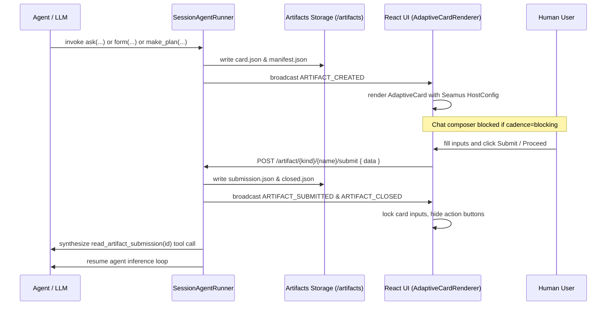

# Adaptive Cards in Seamus

Seamus uses **Microsoft Adaptive Cards (schema v1.5)** as the canonical declarative UI protocol for interactive agent-user artifacts. Adaptive Cards provide a self-contained, typed JSON format for inline chat questionnaires, tabbed forms, and structured plan proposals.

## 1. Protocol Foundations & Schema

All Seamus artifacts conform to the Adaptive Card v1.5 standard:
- **Schema URI**: `http://adaptivecards.io/schemas/adaptive-card.json`
- **Version**: `"1.5"`
- **Core Card Primitives**:
  - `Container`: Groups elements vertically or applies visual emphasis.
  - `ColumnSet` / `Column`: Aligns elements horizontally (e.g. title and status badges).
  - `TextBlock`: Renders text with rich Markdown formatting (headings, code blocks, lists, blockquotes, tables).
  - `Input.ChoiceSet`: Renders single-choice radio buttons (`isMultiSelect: false`) or multi-choice checkboxes (`isMultiSelect: true`) with `style: "expanded"`.
  - `Input.Text`: Captures single-line or multi-line text input (e.g. write-in "Other" fields).
  - `Action.Submit`: Dispatches structured events and inputs back to the harness.

---

## 2. Artifact Directory Structure & Persistence

All artifacts reside inside the session workspace under `<session_dir>/artifacts/` and are mounted **read-only** (`readOnly=True`) inside OpenSandbox containers at `/artifacts/`.

```
/artifacts/
├── questionnaires/
│   ├── manifest.json              # Class manifest (exposition=embedded, cadence=blocking)
│   └── <artifact_uuid>/
│       ├── card.json              # Canonical Adaptive Card JSON payload
│       ├── submission.json        # Canonical user-submitted response values
│       └── closed.json            # Status marker (present if and only if artifact is closed)
├── forms/
│   ├── manifest.json              # Class manifest (exposition=tabbed, cadence=nonblocking)
│   └── <artifact_uuid>/
│       ├── manifest.json          # Instance manifest (overriding tab title)
│       ├── card.json              # Canonical Adaptive Card JSON payload
│       ├── submission.json        # User response values
│       └── closed.json            # Status marker
└── plans/
    ├── manifest.json              # Class manifest (exposition=tabbed, cadence=nonblocking)
    └── <plan_uuid>/
        ├── manifest.json          # Instance manifest (plan title)
        ├── card.json              # Structured document card + Proceed action
        ├── plan.md                # Canonical Markdown plan content
        └── closed.json            # Status marker (written on approval or discard)
```

### Hierarchical Resolution
`ArtifactResolver` looks up artifact files in order:
1. Instance level: `/artifacts/<kind>/<name>/<filename>`
2. Class level: `/artifacts/<kind>/<filename>`
3. Root level: `/artifacts/<filename>`

**Closure Rule**: An artifact's closed state is determined strictly at the instance level: an artifact is closed if and only if `closed.json` (or `submission.json`) exists in `<session_dir>/artifacts/<kind>/<name>/`. No upward directory traversal occurs for closure.

---

## 3. End-to-End Interaction & Lifecycle



### Step 1: Generation
- **Embedded Questionnaires**: The agent invokes `ask(question, answers, multiple, writein, id)`. Invocations within the same turn are automatically batched by `QuestionnaireBuilder.build_card()` into a single `card.json` under `/artifacts/questionnaires/<uuid>/`. Its manifest specifies `exposition=embedded` and `cadence=blocking`.
- **Tabbed Forms**: The agent invokes `form(question, answers, multiple, writein, id, title)`. Invocations are batched into a tabbed artifact under `/artifacts/forms/<uuid>/` (`exposition=tabbed`, `cadence=nonblocking`).
- **Plan Proposals**: In `Plan/Make` phase, the agent invokes `make_plan(content, name)`. `PlanBuilder.create_plan()` generates a structured document card with a "Proceed to Execution" button (`exposition=tabbed`, `cadence=nonblocking`).

### Step 2: UI Presentation & Host Configuration
- Embedded artifacts are rendered directly inside chat message bubbles.
- Tabbed artifacts are rendered in dedicated workspace tabs adjacent to `Changes`.
- The frontend `AdaptiveCardArtifactRenderer` uses a tailored `AdaptiveCards.HostConfig` matching the Seamus dark theme (`#18181b` surface, `#27272a` borders, `#38bdf8` accent, rounded corners, clean padding).
- Text markdown is processed via `markdown-it` with custom typography classes for headers, lists, code spans, syntax containers, and tables.

### Step 3: Conversational Cadence & Input Constraints
- When any open artifact has `cadence=blocking`, user text input in chat is disabled and the server rejects chat input with HTTP 409 Conflict.
- Non-blocking artifacts (`cadence=nonblocking`) permit continued conversational interaction while the tab remains open.

### Step 4: Submission & Synthetic Tool Call Dispatch
- Clicking `Action.Submit` sends input values to `POST /api/v-alpha/agent/{agent_id}/session/{session_id}/artifact/{kind}/{name}/submit`.
- The runner:
  1. Writes `submission.json` containing submitted values.
  2. Writes `closed.json` marking the artifact closed.
  3. Broadcasts `ARTIFACT_SUBMITTED` and `ARTIFACT_CLOSED` events.
  4. Appends a synthetic `read_artifact_submission(artifact_id)` tool call to the thread.
  5. Resumes agent execution with the submitted data.

---

## 4. Plan Document Architecture & Commenting Readiness

Plan artifacts in Seamus are authored as structured Adaptive Cards with dedicated container IDs:
```json
{
  "$schema": "http://adaptivecards.io/schemas/adaptive-card.json",
  "type": "AdaptiveCard",
  "version": "1.5",
  "body": [
    {
      "type": "Container",
      "id": "plan_header",
      "items": [
        {
          "type": "ColumnSet",
          "columns": [
            { "type": "Column", "items": [{ "type": "TextBlock", "text": "Plan Title", "weight": "Bolder", "size": "Large" }] },
            { "type": "Column", "items": [{ "type": "TextBlock", "text": "Draft Plan", "isSubtle": true }] }
          ]
        }
      ]
    },
    {
      "type": "Container",
      "id": "plan_content",
      "items": [
        { "type": "TextBlock", "text": "# Full Plan Markdown...", "wrap": true }
      ]
    },
    {
      "type": "Container",
      "id": "plan_comments",
      "items": []
    }
  ],
  "actions": [
    {
      "type": "Action.Submit",
      "title": "Proceed to Execution",
      "style": "positive",
      "data": { "action": "proceed_plan", "approved": true }
    }
  ]
}
```

### Commenting Extension Points
- **Reserved Comment Container**: `plan_comments` provides an anchor for injecting comment cards (author, avatar, timestamp, message) and interactive comment inputs.
- **Action Discrimination**: Action payloads distinguish `proceed_plan` from `add_comment` or `submit_feedback`. The renderer and runner route actions cleanly without altering card schemas or blocking plan approvals.

---

## 5. Changes Tab Integration

In the Changes tab, artifacts are treated as first-class workspace deliverables:
- **File Paths**: Displayed as `artifacts/<kind>/<name>/card.json` (and `submission.json` if submitted).
- **Diff View**: Displays git diff of the formatted JSON specification.
- **Rendered View**: Renders the Adaptive Card in read-only mode using `ArtifactRenderer`.
- **Toggle Controls**: Quick switching between "View Card JSON diff" and "Render Adaptive Card".

---

## 6. References & Provenance

- [0031-migrate-a2ui-to-adaptive-cards.md](../decisions/0031-migrate-a2ui-to-adaptive-cards.md)
- [0030-operational-modes-and-plan-mode.md](../decisions/0030-operational-modes-and-plan-mode.md)
- [abstractions.md](./abstractions.md)
- [requirements.md](./requirements.md)
- [invariants.md](./invariants.md)
- [vocabulary.md](./vocabulary.md)

