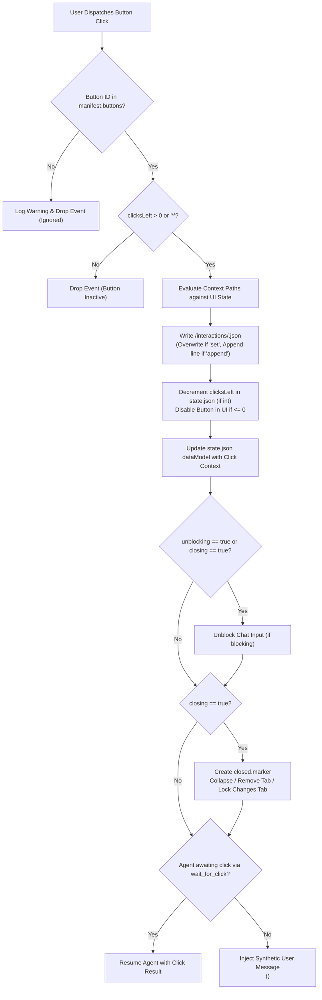

# Seamus Artifacts Specification

This document provides the canonical, durable technical specification for interactive agent artifacts in Seamus. It supersedes previous explorations of A2UI event streaming and Microsoft Adaptive Cards, establishing a mature, opinionated model combining an **A2UI declarative UI subset**, a **dedicated filesystem state hierarchy**, **atomic generation tools**, **explicit Human-in-the-Loop (HITL) waiting**, and **rich inline commenting**.

---

## 1. Overview & Architectural Philosophy

Artifacts are structured, declarative UI surfaces produced by or on behalf of an agent to collect user feedback, review plans, or render interactive forms.

### Design Principles

1. **A2UI Subset for UI Representation**:
   A2UI defines a rich protocol message set (`createSurface`, `updateComponents`, `updateDataModel`, `deleteSurface`, etc.) which Seamus exploits underneath to drive the web frontend renderer. However, persisting multi-file event streams on disk was an internal harness abstraction from early spikes that added unnecessary complexity. Under this model, Seamus uses A2UI JSON purely as a declarative UI component representation (`body.json` corresponds to the `components` list of `updateComponents`). A2UI messages are generated dynamically in-memory and never exposed to the agent or persisted as filesystem event streams.
2. **In-Memory Event Stream Generation**:
   The actual A2UI event stream sent to the web frontend renderer is assembled dynamically in-memory by the harness. It is never persisted to disk as an event stream.
3. **No Multi-Level Component Searching**:
   Component trees in `body.json` are flat sequences of component definitions with explicit identifier references. The harness and renderer do not perform multi-level recursive component lookups across catalog hierarchies.
4. **Decoupled State and Interaction Persistence**:
   Runtime state (`dataModel`, `clicksLeft`) and button click payloads are managed directly in the filesystem by the harness.
5. **Atomic Generation Over Turn-by-Turn Accumulation**:
   The previous model where tools like `ask` accumulated individual questions across turns into a synthetic questionnaire is deprecated. Artifacts are authored atomically in a single tool call (`make_questionnaire`, `make_form`, `make_plan`, `make_artifact`).
6. **Read-Only Sandbox Mount**:
   The `/artifacts/` directory inside the OpenSandbox container is mounted strictly read-only (`readOnly=True`). Agents cannot mutate artifacts via direct file writes or bash commands; all mutations occur through harness-provided tools.

---

## 2. Filesystem Hierarchy & Invariants

All artifacts are persisted within the session workspace under `<session_dir>/artifacts/<family>/<uuid>/`.

```
/artifacts/
└── <family>/                     # e.g. questionnaires, forms, plans, custom
    └── <uuid>/                   # Unique artifact identifier (UUIDv4)
        ├── manifest.json         # Presentation, blocking cadence, and button rules
        ├── body.json             # Declarative A2UI component list
        ├── state.json            # Accumulated dataModel and remaining click counters
        ├── schema.json           # (Optional) Domain schema mapping IDs to original text/labels
        ├── closed.marker         # Marker file indicating artifact is closed (empty or non-empty)
        └── interactions/         # Evaluated button click payloads
            ├── <button_id_1>.json
            └── <button_id_2>.json
```

### Specialized Family Extensions

The artifact filesystem layout is intentionally open to family-specific extensions rather than forcing family metadata into runtime state or ad-hoc data models. Specialized artifact families may store supplementary read-only definition files alongside the core files:
- `schema.json`: In `questionnaires` and `forms`, stores the original prompts, option label dictionaries, and write-in specifications. The harness uses `schema.json` upon button dispatch to translate submitted component keys and choice slugs back into human-readable question text and user-facing labels for agent consumption, cleanly separating presentation mapping from runtime `dataModel`.

### Persistence Invariants

- **INV-ART-001 (No Deletion)**: Artifact files and directories are never deleted during normal operation.
- **INV-ART-002 (Replace vs. Append)**: State files (`manifest.json`, `body.json`, `state.json`) and `mode="set"` interaction files are modified only by complete content replacement. Interaction files with `mode="append"` are modified by appending single-line JSON records (JSONL).
- **INV-ART-003 (Co-existence on Creation & Unusable State)**: `body.json` must exist before or at the exact instant `manifest.json` is created. If `manifest.json` is detected without `body.json`, harness validation fails and artifact initialization is aborted. This leaves the agent turn in an unusable `ERROR` state; recovery requires the user to branch the session off a prior turn (typically reverting the tool call that attempted artifact creation so the agent can retry).
- **INV-ART-004 (Closure Marker)**: An artifact is closed if and only if `closed.marker` exists in its instance directory. The contents of `closed.marker` are ignored (can be empty).
- **INV-ART-005 (Closure Presentation Semantics & Changes Tab Guard)**:
  - If `exposition="tabbed"`, closing the artifact removes its tab from the UI panel.
  - If `exposition="embedded"`, closing the artifact automatically collapses its chat bubble and marks all controls permanently disabled and uneditable.
  - In addition, when viewed in the Changes tab in rendered mode, closed artifacts remain strictly non-editable and visually locked, ensuring the Changes tab cannot serve as an override or backdoor to interact with closed artifacts.
- **INV-ART-011 (Surface Pre-Render Validation on Creation)**: `make_artifact` attempts to render and validate the A2UI component tree and manifest prior to storage. If any rendering or integrity errors occur (unsupported component types, dangling child references, cyclic hierarchies, duplicate IDs, missing required properties, unlisted button IDs, or invalid JSON pointers), the artifact is not stored on disk, no `ARTIFACT_CREATED` event is emitted, and the tool returns a response listing the validation errors and explicitly stating that the artifact was not stored.

---

## 3. Manifest Specification (`manifest.json`)

The manifest defines artifact metadata, presentation rules, conversation blocking behavior, and button dispatch semantics.

### Manifest Schema

```json
{
  "name": "string",
  "exposition": "embedded",
  "blocking": true,
  "commentable": false,
  "buttons": [
    {
      "id": "submit-btn",
      "mode": "set",
      "clicks": 1,
      "unblocking": true,
      "closing": true
    }
  ]
}
```

### Field Definitions

| Field | Type | Description |
| :--- | :--- | :--- |
| `name` | `string` | Display name of the artifact (rendered in tab header or bubble badge). |
| `exposition` | `"tabbed"` \| `"embedded"` | How the artifact is presented in the UI: inline chat bubble (`"embedded"`) or dedicated sidebar tab (`"tabbed"`). |
| `blocking` | `boolean` | If `true`, disables the user text message input in the Web UI until an unblocking button is clicked. |
| `commentable` | `boolean` | If `true`, enables text selection and inline review commenting in the Web UI. |
| `buttons` | `list[Button]` | Explicit whitelist of interactive buttons and their state handling rules. |

### Button Configuration Schema

```json
{
  "id": "string",
  "mode": "set" | "append",
  "clicks": 1 | "*",
  "unblocking": false,
  "closing": false
}
```

| Field | Type | Default | Description |
| :--- | :--- | :--- | :--- |
| `id` | `string` | *(Required)* | Unique button identifier matching the component ID in `body.json`. |
| `mode` | `"set"` \| `"append"` | *(Required)* | Storage format in `/interactions/<id>.json`. `"set"` overwrites with pretty-printed JSON. `"append"` appends a JSONL record. |
| `clicks` | `int` \| `"*"` | `"*"` | Number of clicks allowed before the button becomes inactive. Must be a positive integer (`>= 1`) or `"*"` (unlimited). Non-positive integers (`<= 0`) are disallowed in `manifest.json` and will fail manifest validation upon creation. |
| `unblocking` | `boolean` | `false` | If `true`, clicking this button unblocks the conversation if the artifact is `blocking: true`. Ignored if artifact is non-blocking. |
| `closing` | `boolean` | `false` | If `true`, clicking this button closes the artifact (creates `closed.marker`). **Note:** Closing implicitly triggers unblocking. |

> **Button Whitelisting, Inactivity, and Security Rules**:
> 1. **Visibly Disabled State (`clicksLeft <= 0`)**: For buttons listed in `manifest.json.buttons` whose remaining quota in `state.json` reaches `0` (or negative, if edited externally in Git), the frontend renders the button in a **visibly disabled state** (grayed out, unclickable).
> 2. **Unlisted Buttons Warning**: If a component in `body.json` defines an action but its ID is **not** present in `manifest.json.buttons`, the harness logs a warning during artifact validation or event receipt. If an unlisted button is somehow clicked in the UI, the click is dropped and ignored by the harness.

---

## 4. Body Specification (`body.json`)

`body.json` defines the declarative UI layout as a flat sequence of JSON component objects conforming to the A2UI v0.9 basic catalog. It is identical to the `components` field in an A2UI `updateComponents` event.

### Structure

```json
[
  {
    "id": "root",
    "component": "Column",
    "children": ["title-text", "input-field", "submit-btn"]
  },
  {
    "id": "title-text",
    "component": "Text",
    "text": "Please provide your project preferences",
    "variant": "h2"
  },
  {
    "id": "input-field",
    "component": "TextField",
    "label": "Project Name",
    "value": ""
  },
  {
    "id": "submit-btn",
    "component": "Button",
    "child": "submit-label",
    "variant": "primary",
    "action": {
      "event": {
        "name": "submit_form",
        "context": {
          "projectName": {
            "path": "/components/input-field/value"
          }
        }
      }
    }
  },
  {
    "id": "submit-label",
    "component": "Text",
    "text": "Submit"
  }
]
```

### Action Context Evaluation

When a button with an `action.event` is clicked:
1. The frontend evaluates each path expression in `action.event.context` against the local UI state tree.
2. The evaluated key-value dictionary is submitted to the harness as the event context payload (e.g. `{"projectName": "Seamus"}`).
3. The event name (e.g. `"submit_form"`) is currently ignored by the dispatch pipeline (see Deferred Backlog).

---

## 5. State Management & Lifecycle

Artifact state is initialized automatically by the harness upon artifact creation and updated with each valid button click.

### State Schema (`state.json`)

```json
{
  "dataModel": {},
  "clicksLeft": {
    "submit-btn": 1,
    "refresh-btn": "*",
    "exhausted-btn": 0
  }
}
```

> **Tolerance of Inactive & Negative Values in `state.json`**: While `manifest.json` requires positive integers (`>= 1`) or `"*"`, `state.json` explicitly permits values `<= 0`. A button reaches `0` naturally through normal clicks, at which point the frontend disables the button. If manual external edits in Gitea introduce negative values (e.g. `-1`), the harness treats the button as inactive without raising validation exceptions or crashing.

### Initialization

1. Harness detects creation of `manifest.json` and validates presence of `body.json`.
2. Initial `state.json` is written:
   - `dataModel`: Initialized to empty dictionary `{}`.
   - `clicksLeft`: Initialized from `manifest.json.buttons`, mapping each button `id` to its configured `clicks` value (integer or `"*"`).
3. The artifact is exposed in the Web UI:
   - If `exposition="embedded"`, added as an inline message item.
   - If `exposition="tabbed"`, mounted as a dedicated panel tab.
   - If `blocking=true`, chat input is disabled.

### Click Execution Lifecycle

In the Web UI:
- Buttons with `clicksLeft <= 0` are rendered in a **visibly disabled state** (grayed out and non-clickable).
- When an enabled button is clicked, or an event is dispatched to the harness:



### DataModel Accumulation Scenario

Multiple button clicks incrementally build up `dataModel`:

- Form text fields: `A`, `B`, `C`.
- Button `X` (`mode="set"`): context `{ "A": path(A), "B": path(B) }`.
- Button `Y` (`mode="set"`): context `{ "B": path(B), "C": path(C) }`.

| Step | User Action | Interaction File Written | `state.json` `dataModel` | Notes |
| :--- | :--- | :--- | :--- | :--- |
| 1 | Fields set: `A=A1`, `B=B1`, `C=C1`. Click `X`. | `interactions/X.json` = `{"A": "A1", "B": "B1"}` | `{"A": "A1", "B": "B1"}` | `X` writes `A` and `B`. |
| 2 | Field updated: `B=B2`. Click `Y`. | `interactions/Y.json` = `{"B": "B2", "C": "C1"}` | `{"A": "A1", "B": "B2", "C": "C1"}` | `B` updated to `B2`; `C` added as `C1`. |
| 3 | Fields updated: `A=A2`, `B=B3`. Click `Y`. | `interactions/Y.json` = `{"B": "B3", "C": "C1"}` | `{"A": "A1", "B": "B3", "C": "C1"}` | `A` was not in `Y`'s context; `A` remains `A1` in `dataModel`. |

---

## 6. Agent Tools

Agents interact with artifacts strictly through structured tools.

### 1. Manifest Pydantic Models & `make_artifact`

The manifest schema is modeled explicitly using Pydantic:

```python
from typing import Any, Literal
from pydantic import BaseModel, Field, field_validator


class ManifestButton(BaseModel):
    id: str
    mode: Literal["set", "append"]
    clicks: int | Literal["*"] = "*"
    unblocking: bool = False
    closing: bool = False

    @field_validator("clicks")
    @classmethod
    def validate_positive_clicks(cls, v: int | str) -> int | str:
        if isinstance(v, int) and v < 1:
            raise ValueError("Button clicks in manifest must be a positive integer (>= 1) or '*'")
        if isinstance(v, str) and v != "*":
            raise ValueError("Button clicks must be an integer or '*'")
        return v


class ArtifactManifest(BaseModel):
    name: str
    exposition: Literal["tabbed", "embedded"]
    blocking: bool = False
    commentable: bool = False
    buttons: list[ManifestButton] = Field(default_factory=list)


def make_artifact(
    family: str,
    manifest: ArtifactManifest,
    components: list[dict[str, Any]],
) -> str:
    """Create a new artifact atomically.

    Validates that the components and manifest form a valid, renderable A2UI surface.
    If validation fails, the artifact is not stored and the tool returns a string detailing
    the validation errors and explicitly stating that the artifact was not stored.

    Args:
        family: Subdirectory family under /artifacts (e.g. 'custom', 'questionnaires', 'forms', 'plans').
        manifest: Strongly-typed artifact manifest specification.
        components: List of A2UI basic catalog component objects.

    Returns:
        The generated artifact UUID string on success, or an error description stating that
        the artifact was not stored on validation failure.
    """
```

### 2. `make_questionnaire`
Specialized template over `make_artifact` for closed surveys.

```python
class Question(BaseModel):
    body: str
    answers: list[str]
    multiple_choice: bool = False


def make_questionnaire(questions: list[Question]) -> str:
    """Create an atomic questionnaire artifact.

    Configuration:
      - family: 'questionnaires'
      - exposition: 'embedded'
      - blocking: True
      - buttons: single submit button with mode='set', clicks='*',
                 unblocking=True, closing=True.
    """
```

### 3. `make_form`
Specialized template over `make_artifact` for multi-field forms and structured surveys.

Effectively the same structure as `make_questionnaire`, but configured for a tabbed workspace rather than an inline chat bubble:
- **Configuration**:
  - `family: "forms"`
  - `exposition: "tabbed"` (renders in a dedicated sidebar tab)
  - `blocking: False` (non-blocking, allowing continued conversational dialogue while the form remains editable in its tab)
  - `buttons`: submit button with `mode="set"`, `clicks="*"`, `unblocking=False`, `closing=True`.

### 4. `make_plan`
Specialized template over `make_artifact` for session implementation plans.

```python
def make_plan(
    title: str,
    content: str,  # Markdown document body
) -> str:
    """Create an atomic plan artifact.

    Configuration:
      - family: 'plans'
      - exposition: 'tabbed'
      - blocking: False
      - commentable: True (enables inline text selection and review comments)
      - buttons:
          - proceed-btn: mode='set', clicks='*', unblocking=True, closing=True
          - review-btn: action={"comments": "push"} for inline comment submission
    Writes:
      - /artifacts/plans/<uuid>/manifest.json
      - /artifacts/plans/<uuid>/body.json (structured A2UI document)
      - /artifacts/plans/<uuid>/plan.md (canonical Markdown document)
    """
```

### 5. `wait_for_click`
Explicit agent wait tool realizing Human-in-the-Loop suspension.

```python
class ClickResult(BaseModel):
    artifact_id: str
    button_id: str
    context: dict[str, Any]
    timestamp: float  # Last modification timestamp (mtime) of the interaction file


def wait_for_click(
    artifact_id: str,
    button_id: str = "*",
    fresh: bool = True,
) -> ClickResult:
    """Halt agent execution until a button in the specified artifact is clicked.

    Args:
        artifact_id: The UUID of the target artifact.
        button_id: Specific button ID to await, or '*' to await any active button.
        fresh: If True, waits until a click occurs strictly AFTER this tool is invoked.
               If False, returns immediately if the button was already clicked;
               otherwise waits for a click.

    Returns:
        ClickResult containing evaluated payload, clicked button ID, and timestamp.
    """
```

---

## 7. Interaction Delivery & Synthetic Message System

Artifact interactions are delivered to the agent through two distinct channels depending on whether the agent explicitly paused to await user action.

### Case 1: Agent Calls `wait_for_click` (Direct HITL Suspension)
1. Agent creates an artifact (e.g. `blocking=True`).
2. Agent immediately invokes `wait_for_click(artifact_id=..., button_id=...)`.
3. The runner suspends agent execution.
4. If the artifact was configured with `blocking: true`, the Web UI chat input area is disabled.
5. User clicks an active button.
6. The runner wakes the agent, returning the `ClickResult` as the tool output.
7. Agent generates assistant response. If the artifact was blocking and the button was `unblocking: true` or `closing: true`, user chat input is re-enabled once the assistant turn completes.

### Case 2: Agent Finishes Turn Without Calling `wait_for_click` (Asynchronous / Completed Assistant Messages)
Regardless of whether an artifact was configured as `blocking: true` or `blocking: false`, if the agent concludes its turn with an assistant message without calling `wait_for_click(...)`:
1. If the artifact is `blocking: true`, the Web UI chat input area remains disabled until an unblocking button is clicked. If `blocking: false`, the user is free to either type text messages or interact with artifact buttons.
2. When the user clicks an active button on the artifact, because no tool invocation is suspended awaiting that click, the harness delivers the interaction payload by injecting a synthetic user message into the thread conversation:

```
<SYNTHETIC MESSAGE INDICATOR>
An artifact "Project Requirements Questionnaire" (uuid: 9b1deb4d-3b7d-4bad-9bdd-2b0d7b3dcb6d) was interacted with. The following event occurred:
{
  "button_id": "submit-btn",
  "context": {
    "framework": "FastAPI",
    "database": "PostgreSQL"
  },
  "timestamp": 1730919245.123
}
```

### Indicator Token & System Prompt Guardrails
- **Token**: The literal prefix `<SYNTHETIC MESSAGE INDICATOR>` is reserved exclusively for harness-injected system notifications.
- **System Prompt Guidance**: The dynamic system prompt instructs the agent:
  > When a message begins with `<SYNTHETIC MESSAGE INDICATOR>`, it is an automated technical notification injected by the harness reporting a user interaction event on an artifact (such as a button click, form submission, or plan approval) while the agent was not actively awaiting a tool call. You must treat the enclosed event context and data model as ground-truth user input describing what the user submitted in the UI, even though no human manually typed the notification text itself.
- **UI Guardrail**: The Web UI strictly prevents human users from submitting any message starting with `<SYNTHETIC MESSAGE INDICATOR>`.

---

## 8. Inline Commenting & Review Action

For review-oriented artifacts (such as plans or requirements documents), setting `commentable: true` in `manifest.json` enables document-level inline commenting.

### Workflow

1. **Selection & Entry**: The user selects a span of rendered Markdown text in the Web UI. A comment popover appears, allowing the user to type feedback.
2. **Client-Side Buffering**: Comments are stored in a transient frontend array and visually highlighted on the document.
3. **Dispatch via Review Component**:
   The agent places a `Review` component in `body.json`:
   ```json
   {
     "id": "review-btn",
     "component": "Review",
     "child": "review-label",
     "variant": "primary",
     "action": {
       "comments": "push"
     }
   }
   ```
4. **Harness A2UI Rewriting & Dynamic Click-Time Capture**:
   When the harness generates the in-memory A2UI event stream for the renderer, it rewrites `{"comments": "push"}` into a standard A2UI action event:
   ```json
   "action": {
     "event": {
       "name": "push_comments",
       "context": {
         "comments": [
           {
             "location": {
               "raw_start": "L12:0",
               "raw_end": "L14:45",
               "rendered_start": "L10:0",
               "rendered_end": "L12:30"
             },
             "span_text": "### Phase 2: Database Migration",
             "comment": "Please use Alembic rather than raw SQL scripts."
           }
         ]
       }
     }
   }
   ```
   > **Dynamic Capture at Click Time**: The rewritten comment payload is **not** statically resolved at render time. Instead, the rewritten A2UI action tells the frontend renderer to evaluate the dynamic comment buffer at the exact moment the button is clicked, populating `context.comments` with all entries accumulated since the previous push.

5. **Buffer Clearing**: Upon click, the frontend dispatches the accumulated comments payload to the harness and immediately resets its local comment buffer (so subsequent clicks only dispatch newly added comments).

---

## 9. Agent Skills & Guidance

Two bundled skills govern artifact usage:

### 1. `artifacts` Skill
- Instructs the agent on the lifecycle, layout, and usage of interactive artifacts.
- Emphasizes that `/artifacts` is mounted read-only (`readOnly=True`) inside OpenSandbox. All creations and edits must use the provided tools (`make_questionnaire`, `make_form`, `make_plan`, `make_artifact`).
- **Guidance**: Emphasizes that custom artifacts (`make_artifact`) are rarely needed; specialized tools (`make_questionnaire`, `make_form`, `make_plan`) must be preferred. Existing specialized artifacts can serve as syntax examples when custom authoring is required.

### 2. `a2ui-components` Skill
- Provides reference documentation for all components available in the default A2UI basic catalog (`Text`, `Button`, `TextField`, `ChoiceSet`, `Column`, `Row`, `Card`, `Review`, etc.).
- Ships with the downloaded basic catalog specification:
  `src/seamus/skills/bundled/a2ui_components/resources/catalog.json` (downloaded from `https://github.com/a2ui-project/a2ui/blob/main/specification/v0_9/catalogs/basic/catalog.json`).

---

## 10. Traceability & Invariants Summary

| Identifier | Subject | Description |
| :--- | :--- | :--- |
| `INV-ART-001` | Filesystem | No artifact files or directories are deleted. |
| `INV-ART-002` | State Mutation | State files overwrite; append-mode interactions append JSONL. |
| `INV-ART-003` | Co-existence | `body.json` must exist when `manifest.json` is created; violation leads to unrecoverable `ERROR` turn state requiring branching. |
| `INV-ART-004` | Closure Marker | Existence of `closed.marker` marks artifact as closed. |
| `INV-ART-005` | Presentation on Close | Closed tabbed artifacts unmount; closed embedded artifacts collapse and lock; closed artifacts in Changes tab rendered mode are non-editable. |
| `INV-ART-006` | Whitelisted Clicks | Button clicks for IDs not listed in `manifest.json.buttons` log a warning and are ignored; buttons with `clicksLeft <= 0` are rendered disabled. |
| `INV-ART-007` | Hitl Suspension | `wait_for_click` suspends agent execution until target click event. |
| `INV-ART-008` | Synthetic Notification | If agent finishes turn without `wait_for_click`, user clicks inject `<SYNTHETIC MESSAGE INDICATOR>`. |
| `INV-ART-009` | Review Rewriting | `{"comments": "push"}` action is rewritten to dynamic click-time `push_comments` event context with `LN:M` locations. |
| `INV-ART-010` | Read-Only Sandbox | Sandbox mounts `/artifacts` as `readOnly=True`. |
| `INV-ART-011` | Surface Validation | `make_artifact` validates A2UI surface before storage; invalid surfaces are not stored on disk and return errors with "did not store" notification. |
| `INV-ART-012` | Root Component & Structure Warning | Every A2UI surface resolves from a root component; if `id='root'` is missing or multiple disconnected roots exist, a root `Column` container is synthesized during normalization to prevent blank renders, and static incomplete structure warnings are returned to the agent. |
| `INV-ART-013` | Loose Normalization & Mutation Log | `normalize_a2ui_components` loosely parses component trees (auto-assigning missing IDs, mapping type aliases, synthesizing Button child and Card content Column, auto-declaring manifest buttons) and returns an educational mutation log to the agent in `make_artifact` tool responses. |
