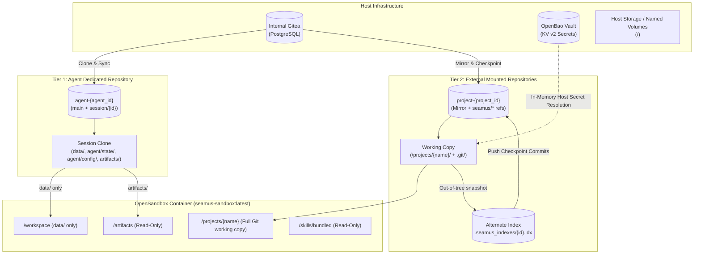
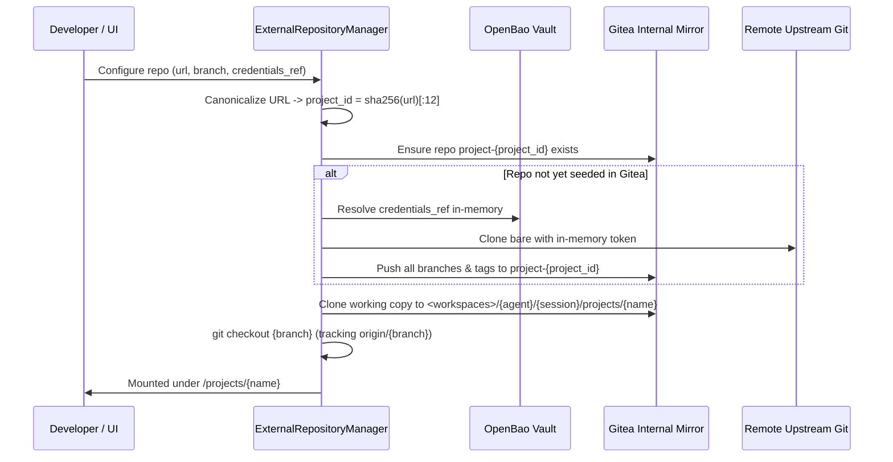
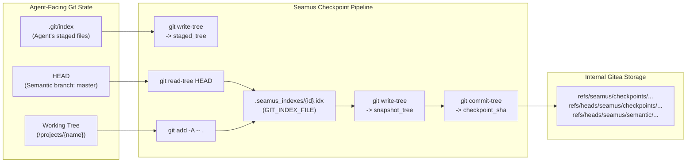

# Persistence in Seamus

A comprehensive, one-stop guide to persistence, storage topology, and filesystem sandboxing in Seamus.

---

## 1. Core Philosophy: Never Mount Live Host Filesystems

The bedrock principle of Seamus is that **the developer's live host filesystem must never be mounted into the agent's execution environment**.

### Why Live Filesystem Mounting Is Prohibited

1. **Destructive Safety**: Language models generate commands autonomously. Giving an agent direct read/write access to a developer's workstation or active git working directory risks unintended file deletion (`rm -rf`), corrupted local git states, rogue process management, network socket manipulation, and accidental modification of non-versioned personal files.
2. **Reproducibility & Determinism**: If an agent operates on a live host tree, the state of the workspace depends on local developer environment quirks, untracked host tools, uncommitted files, and mutable filesystem paths. Work cannot be deterministically branched, replayed, or verified.
3. **Container Ephemerality**: Execution sandboxes are transient compute vessels, not the authoritative storage layer. If a sandbox breaks packages, fills the disk, crashes, or hangs, the container can be killed and recreated without losing a single line of deliverable code or conversational history.
4. **Auditability & Provenance**: Every state transition—whether an agent code edit, user review, artifact button click, or configuration update—must be committed to Git. Mounting live host filesystems bypasses this audit trail.

---

## 2. Persistence Architecture Overview

Seamus structures persistence into two independent Git-native tiers, backed by a self-hosted Gitea instance and an OpenBao secrets vault:



---

## 3. Tier 1: Dedicated Agent Repository (`agent-{agent_id}`)

Every agent owns a dedicated Gitea Git repository named `agent-{agent_id}`. This repository is the **single authoritative source of truth** for everything the agent knows, produces, and configures.

### Repository Layout

Inside `agent-{agent_id}`, the tree is strictly divided into harness metadata and user deliverables:

```text
agent-{agent_id}/
├── agent/
│   ├── config/
│   │   └── config.json           # Agent & session config (version-exploded secrets)
│   └── state/
│       ├── turns.json            # Turn counters, active thread ID, inquiry state
│       └── external_checkpoints.json # Dual-index checkpoint records for mounted repos
├── artifacts/
│   └── {family}/
│       └── {artifact_id}/
│           ├── manifest.json     # A2UI declarative manifest and buttons
│           ├── body.json         # A2UI surface component tree
│           ├── state.json        # User input values and evaluated contexts
│           └── interactions/     # Click log files for unblocking buttons
└── data/                         # Deliverables, code, notes, operational files
```

### The `/workspace` Mount & Harness Isolation

Only the `data/` subdirectory is mounted into the OpenSandbox container at `/workspace`:

- The agent **cannot access** `.git/`, `agent/config/`, or `agent/state/`.
- The agent cannot corrupt its own Git history, inspect raw prompt scaffolding, or manipulate turn states.
- The agent's tools observe `/workspace` as a clean, normal filesystem root.
- Mount permissions adapt dynamically across operational modes:
  - `chat` and `plan/discuss`: `/workspace` is mounted **Read-Write**.
  - `plan/make`: `/workspace` is mounted strictly **Read-Only** to prevent code modifications while authoring implementation plans.
  - `plan/execute`: `/workspace` is **Read-Write**, but `/workspace/notes` is mounted **Read-Only** to safeguard historical requirements and research.

### Session Branches & Checkpoint Saver

- When a session ($S_1$) is initialized, it checks out a session branch `session/{session_id}` from `main`.
- During inference, Seamus's `GitCheckpointSaver` hooks into LangGraph's execution loop:
  1. Captures conversation events and updates `agent/state/`.
  2. Stages modifications made by the agent inside `data/` and `agent/state/`.
  3. Commits to the session branch with prefix `checkpoint: [turn={turn_id} run={run_id}]`.
  4. Pushes the session branch to Gitea.
- The session working copy is persisted on a host-managed volume (`seamus-workspaces`), surviving container restarts and crashes.

### Sync PRs and Atomic Thread Acceptance

1. When a session is created, Seamus automatically opens a **Sync Pull Request** in Gitea from `session/{session_id}` targeting `main`.
2. The Web UI "Changes" tab visualizes the live diff of `data/` between `main` and `session/{session_id}` via `@pierre/diffs`.
3. When the user reviews deliverables and clicks **Accept**:
   - The active thread is closed.
   - `GitWorkspaceManager.merge_sync_pr` executes an atomic, **data-scoped merge** into `main`. Only modifications within `data/` are applied to `main`. Session-specific configuration and thread checkpoints are excluded, keeping `main` clean.
   - A new thread is opened on the session branch, and a renewed Sync PR to `main` is created automatically.

### Session Branching (Time-Travel)

Users can branch a session from any historical assistant turn:
- Seamus identifies the exact agent repository commit SHA corresponding to that assistant turn (`RUN_FINISHED`).
- A child session ($S_2$) is created, branching its Git history from that exact commit.
- $S_2$ opens its own Sync PR to `main`, records provenance and cumulative lineage, and leaves the parent session ($S_1$) completely untouched.

---

## 4. Tier 2: External Mounted Repositories (`/projects/{mount_name}`)

While `/workspace` houses the agent's dedicated workspace deliverables, developers often need agents to inspect, refactor, or test existing codebases without treating those projects as agent harness deliverables.

Seamus supports mounting an arbitrary number of external Git repositories under `/projects/{mount_name}`.

### 4.1 Upstream Mirroring & Forking in Gitea

Users configure external repositories in `AgentConfig.repositories` (or session overrides) using `ExternalRepositoryConfig`:
- `url`: Remote Git repository URL (e.g. `https://github.com/FilipMalczak/seamus.git`).
- `branch`: Configured upstream branch to check out (e.g. `master` or `main`).
- `credentials_ref`: Optional OpenBao symbolic secret reference (`${secret(path=...)}`).



1. **Deterministic Project Identity**: The upstream URL is canonicalized, computing `project_id = sha256(canonical_url)[:12]`.
2. **Internal Gitea Mirror**: Seamus provisions an internal mirror repository named `project-{project_id}` in Gitea.
3. **In-Memory Credential Safety**: Upstream credentials (OAuth tokens, personal access tokens) are resolved synchronously on the host by `ExternalRepositoryManager` using OpenBao. Credentials are **never written to disk, committed to Git, or exposed in container environment variables**.

### 4.2 Deterministic Mount Naming & Collision Resolution

Mount names are derived deterministically from the trailing component of the repository URL (stripping `.git` and trailing slashes, normalized to alphanumeric + hyphen/underscore):
- `https://github.com/FilipMalczak/seamus.git` $\to$ `/projects/seamus`
- `https://github.com/example/payments-api` $\to$ `/projects/payments-api`

If multiple configured repositories produce the same base name, numeric suffixes are appended to **all** colliding entries:
- `https://github.com/team-a/core.git` $\to$ `/projects/core_0`
- `https://github.com/team-b/core.git` $\to$ `/projects/core_1`
- `https://github.com/team-c/core.git` $\to$ `/projects/core_2`
Unique repository names receive no numeric suffix.

### 4.3 Agent-Facing Git Environment

Inside `/projects/{mount_name}`:
- The directory contains a **fully functional, standard Git working tree**, including `.git/` and the ordinary Git index.
- The working copy is checked out directly on the configured upstream branch (`repo_config.branch`, e.g. `master`), tracking `origin/{repo_config.branch}`.
- The agent observes standard Git output:
  ```bash
  $ git status
  On branch master
  Your branch is up to date with 'origin/master'.
  ```
- The agent can execute standard Git operations without wrapper tools:
  `git status`, `git diff`, `git diff --cached`, `git add`, `git commit`, `git log`, `git branch`, `git checkout`.

### 4.4 The Dual-Index Checkpoint Architecture

Seamus must automatically snapshot mounted repositories whenever LangGraph creates a checkpoint. However, **Seamus checkpoints must not pollute the project's semantic Git history or alter the Git state observed by the agent**.

To achieve this, Seamus implements a **dual-index architecture**:



#### Dual-Index Steps During Checkpoint

1. **Capture Ordinary Staged Index**:
   Seamus executes `git write-tree` against the agent's active `.git/index`. This produces `staged_tree`, recording any staged changes made by the agent without modifying `.git/index`.
2. **Alternate Checkpoint Index**:
   Seamus targets an external, out-of-tree Git index file:
   `<workspace_root>/{agent_id}/{session_id}/.seamus_indexes/{attachment_id}.idx`
   passed via the `GIT_INDEX_FILE` environment variable.
3. **Initialize Alternate Index from HEAD**:
   `git read-tree HEAD` populates the alternate index with the current semantic `HEAD`.
4. **Stage Working-Tree Modifications**:
   `git add -A -- .` runs against the alternate index, capturing all untracked and modified files while natively respecting the project's `.gitignore`.
5. **Write Snapshot Tree**:
   `git write-tree` against the alternate index generates `snapshot_tree`, representing the complete filesystem state of the project at checkpoint time.
6. **Create Checkpoint Commit with Separate Ancestry**:
   Seamus creates a checkpoint commit using `git commit-tree snapshot_tree -p {prev_checkpoint_sha}`. Checkpoint commits form an independent ancestry line and **never fast-forward or touch the agent's semantic branch**.
7. **Push to Gitea**:
   The commit and tree objects are pushed to the Gitea mirror repository:
   - Immutable checkpoint ref: `refs/seamus/sessions/{session_id}/attachments/{id}/checkpoints/{checkpoint_id}`
   - Latest snapshot ref: `refs/seamus/snapshots/{session_id}/{id}`
   - Visible inspection branch: `refs/heads/seamus/checkpoints/{session_id}/{mount_name}`
   - Semantic commits backup: `refs/heads/seamus/semantic/{session_id}/{mount_name}`

#### Agent Index Preservation Invariant

After Seamus completes a checkpoint snapshot:
- `git status` executed by the agent produces output **100% identical** to before the checkpoint.
- Untracked files remain untracked.
- Staged files remain staged.
- The working tree does not appear clean, and `HEAD` does not move.

### 4.5 Multi-Repository Checkpoint Ordering & Atomic Manifest

When a session has external repositories configured:
1. **Ordering Invariant**: Seamus checkpoints and pushes all external repositories **before** committing the agent repository checkpoint.
2. **Metadata Manifest**: For each mounted repo, a `MountedRepositoryCheckpointRecord` is written to `agent/state/external_checkpoints.json`:
   - `attachment_id`, `project_id`, `mount_name`, `url`, `branch`
   - `semantic_head` and `semantic_branch`
   - `staged_tree` (agent's staged state)
   - `snapshot_tree` (full working tree snapshot)
   - `checkpoint_sha` (durable checkpoint commit SHA)
   - `gitea_repo_name` and `gitea_repo_url` (internal Gitea mirror mapping)
3. **Atomic Provenance**: `external_checkpoints.json` is committed directly into the agent repository's session branch, guaranteeing that agent turns and external repository states remain atomically synchronized.

### 4.6 Exact Historical Reconstruction & Session Branching

When a user branches a session or recovers from an interrupted turn:
1. The target agent repository commit contains `external_checkpoints.json`.
2. For each mounted repository, `ExternalRepositoryManager.restore_working_copy_checkpoint` reconstructs the working copy:
   - Checks out the recorded semantic `HEAD` on `semantic_branch`:
     `git checkout -B {semantic_branch} {semantic_head}`
   - Restores untracked and modified working-tree files without touching the Git index:
     `git archive {snapshot_tree} | tar -x`
   - Restores the agent's ordinary staged index from `staged_tree`:
     `git read-tree {staged_tree}`
3. The reconstructed directory possesses the exact same `git status`, staged files, unstaged changes, and untracked files as when the checkpoint was captured.

---

## 5. Tier 3: Configuration & Secrets Persistence

Configuration persistence must guarantee that historical replays run with identical configuration while preventing secrets from ever being committed to Git.

### OpenBao Vault Integration & Version Explosion

1. **Symbolic Expressions**: Configuration fields (e.g. `InferenceConfig.api_key`, `ExternalRepositoryConfig.credentials`) store symbolic expressions:
   `${secret('/path/to/key')}`
2. **In-Memory Interpolation**: When initializing LLM clients or Git credentials, Seamus resolves secret values in-memory directly from OpenBao.
3. **Version Explosion at Checkpoint**:
   When `GitWorkspaceManager` or `GitCheckpointSaver` writes `agent/config/config.json` to disk for a commit, it converts unversioned references to version-pinned exploded references:
   `${secret(path='/path/to/key', field='value', version=3)}`
4. **Reproducibility Without Leakage**:
   The exploded configuration records the exact secret version active at that turn. If secrets are rotated in OpenBao later, historical session branches can reconstruct the exact credentials used in the past without ever storing cleartext keys in Git.

---

## 6. Summary Comparison: `/workspace` vs `/projects/{name}`

| Property | Agent Workspace (`/workspace`) | External Repositories (`/projects/{name}`) |
| :--- | :--- | :--- |
| **Source Authority** | Dedicated agent repository (`agent-{agent_id}`) | Internal Gitea mirror (`project-{project_id}`) of upstream Git URL |
| **Container Path** | `/workspace` | `/projects/{mount_name}` |
| **Host Working Directory** | `<workspaces>/{agent_id}/{session_id}/data/` | `<workspaces>/{agent_id}/{session_id}/projects/{mount_name}/` |
| **Agent Git Access** | **No** (Harness controls Git; `.git/` is hidden) | **Yes** (Normal Git working copy with `.git/` and full Git CLI) |
| **Agent Branch** | N/A (operates on unversioned `data/` root) | Configured branch (`repo_config.branch`, e.g. `master` or `main`) |
| **Checkpoint Strategy** | Whole-directory commit on `session/{session_id}` | Dual-index snapshot (`GIT_INDEX_FILE` out-of-tree index) |
| **Deliverable Merging** | Data-scoped Sync PR merge into `main` | Independent semantic commits or upstream PRs |
| **Unmount Semantics** | Retained in agent repository | Working tree discarded; starts clean from upstream branch on remount |

---

## Cross-References

- [architecture.md](./architecture.md) — System components, dependencies, and execution lifecycles.
- [abstractions.md](./abstractions.md) — Protocols, managers, and service contracts (`GitWorkspaceManager`, `ExternalRepositoryManager`).
- [invariants.md](./invariants.md) — Core invariants (`INV-007`, `INV-012`, `INV-036`, `INV-042`, `INV-043`, `INV-044`, `INV-045`).
- [requirements.md](./requirements.md) — Stable requirements (`REQ-008`, `REQ-012`, `REQ-035`, `REQ-036`).
- [vocabulary.md](./vocabulary.md) — Canonical terminology (Agent Repository, Dual-Index Checkpoint, Exploded Secret Reference).
- [0008-git-persistence.md](../decisions/0008-git-persistence.md) — Foundational Gitea persistence and Sync PR architecture.
- [0012-sync-prs-and-thread-accept.md](../decisions/0012-sync-prs-and-thread-accept.md) — Atomic thread acceptance and deliverable merge lifecycle.
- [0041-openbao-secrets-vault-integration.md](../decisions/0041-openbao-secrets-vault-integration.md) — OpenBao secrets vault, version explosion, and secret interpolation.
- [0042-mount-external-git-repositories.md](../decisions/0042-mount-external-git-repositories.md) — Architectural decision for mounting external Git repositories with dual-index persistence.
