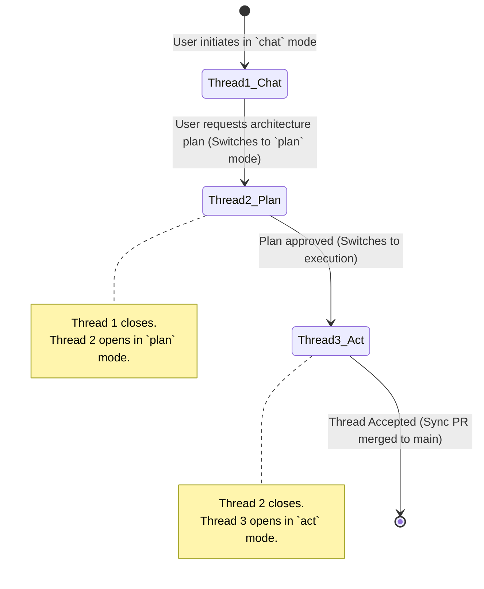

# Threads, Modes, and Personas

Architectural vision and specification for Seamus's core agent configuration and execution triad, established in [0019-threads-modes-personas-architecture.md](../decisions/0019-threads-modes-personas-architecture.md).

---

## 1. The Architectural Triad

To balance autonomous execution, safety, and multi-domain versatility, Seamus separates configuration and execution into three distinct layers:

```
+-------------------------------------------------------------+
| Agent (Persona)                                             |
| Baseline Identity, Domain Specialization, Available Tools  |
+-------------------------------------------------------------+
                              |
                              v
+-------------------------------------------------------------+
| Session (Workspace & Git Branch)                            |
| Dedicated Sandbox Container, `session/{id}` Git Branch      |
+-------------------------------------------------------------+
                              |
                              v
+-------------------------------------------------------------+
| Thread (Mode & Execution Phase)                             |
| Active Operational Posture, Checkpoint State, Event Stream  |
+-------------------------------------------------------------+
```

| Layer | Concept | Cardinality | Primary Question | Persistence Scope |
| :--- | :--- | :--- | :--- | :--- |
| **Agent** | **Persona** | 1 per Agent | *What is the agent?* | Baseline identity in `agent/config/config.json` (switching rules TBD) |
| **Session** | **Workspace** | 1..* per Agent | *Where does it operate?* | Dedicated sandbox container & Git branch (`session/{id}`) |
| **Thread** | **Mode** | 1..* per Session | *How does it behave right now?* | Checkpoints in `agent/state/threads/{id}/` & event stream |

---

## 2. Personas (Agent Level)

A **Persona** defines an agent's enduring identity, domain background, and available capabilities. 

### Extensibility and Near-Term Focus

- **Open and Extensible**: Personas are not a hardcoded or closed enumeration. While custom persona creation by users is a post-MVP capability, the harness architecture is designed to support arbitrary custom personas.
- **Near-Term Coder Focus**: While example archetypes illustrate the versatility of the harness, near-term development is focused squarely on the **Coder** persona. The primary upcoming milestone is using Seamus to develop Seamus itself (dogfooding).
- **Switching Rules TBD**: Exact lifecycle constraints regarding runtime persona switching across sessions or threads remain intentionally TBD.

### Example Persona Archetypes

1. **Coder** (Primary Focus):
   - **Identity**: Autonomous AI software engineering agent with rigorous engineering discipline, surgical diffs, and verification testing.
   - **Default Tools**: Sandbox filesystem tools (`read_file`, `write_file`, `edit_file`, `ls`, `glob`, `grep`) and shell execution (`execute`).
   - **System Prompt**: Embeds `<engineering_discipline>` and testing invariants.

2. **Office Worker** (Example):
   - **Identity**: Executive coordinator and administrative assistant specializing in organization, synthesis, task dispatching, and communication.
   - **Default Tools**: Document parsers, task tracking tools (`write_todos`), and integration endpoints.
   - **System Prompt**: Emphasizes clarity, structured bulleted summaries, and actionable next steps.

3. **Designer** (Example):
   - **Identity**: Product and user-experience designer focused on design systems, visual hierarchy, user ergonomics, and frontend aesthetics.
   - **Default Tools**: Filesystem access for CSS/component styling, SVG/canvas generation, and artifact viewers.
   - **System Prompt**: Emphasizes layout proportions, contrast, typography, and interactive usability.

4. **Data Scientist** (Example):
   - **Identity**: Quantitative researcher and data analyst focused on data exploration, statistical modeling, and experimental reproducibility.
   - **Default Tools**: Python sandbox execution, data file inspection, and visualization artifact generation.
   - **System Prompt**: Emphasizes validation, baseline comparisons, and reproducible data workflows.

---

## 3. Operational Modes (Thread / Turn Level)

An **Operational Mode** dictates the agent's immediate interaction posture, prompt framing, and the role of the operational workspace (`/workspace`).

Modes are **open and creatable**—the core list below is an illustrative set, not a closed enumeration. New modes can be registered as the harness evolves. For detailed mode-by-mode and persona-by-persona customization (prompt framing, tool gating, and mount policies), see [modes_and_personas_breakdown.md](./modes_and_personas_breakdown.md).

```
+--------------------------------------------------------------------------------+
|                             OPERATIONAL MODES                                  |
+--------------------------------------------------------------------------------+
|  MODE     | PRIMARY OBJECTIVE        | WORKSPACE ROLE       | TOOL CONSTRAINTS |
|-----------+--------------------------+----------------------+------------------|
| `plan`    | Plan first, then execute | Scratchpad -> Prod   | Read-only -> Mod |
| `chat`    | Conversational dialogue  | Scratchpad only      | Transient/Temp   |
| `act`     | Immediate task execution | Production codebase  | Full modify/exec |
| `analyse` | Workspace investigation  | Immutable reference  | Strict read-only |
| `routing` | Triage and mode dispatch | None                 | Classifier only  |
+--------------------------------------------------------------------------------+
```

### Detailed Mode Semantics

#### `plan`
- **Objective**: Formulate a structured, verified plan across three sequential phases (**Discuss** -> **Make** -> **Execute**) before modifying production deliverables.
- **Workflow**:
  1. *Discuss Phase* (`plan/discuss`): The agent explores `/workspace` (mounted read-write) and clarifies requirements with the user (via `make_questionnaire`, `make_form`, or conversation), recording all findings, specifications, and notes across `/workspace` without directory restrictions. The agent is explicitly constrained from implementing code or writing the plan artifact during Discuss. Calling `plan()` spawns a fresh `plan/make` thread.
  2. *Make Phase* (`plan/make`): Synthesizes requirements into a session-local Plan artifact (`exposition="tabbed"`, `blocking=false`, `commentable=true`) via `make_plan` with `/workspace` mounted read-only. Clicking the "Proceed" button advances the session to Execute.
  3. *Execute Phase* (`plan/execute`): Spawns a fresh execution thread with `/workspace` mounted read-write and `/workspace/notes` mounted read-only to implement and test the approved plan.
  4. *Discarding*: Calling `discard()` in any phase discards active plans and returns the session to a fresh `plan/discuss` thread.
- **Workspace Role**: Mounted read-write in Discuss for unconstrained context gathering and note-taking; mounted read-only in Make for plan formulation; becomes the target of verified changes in Execute.

#### `chat`
- **Objective**: Conversational discussion, brainstorming, high-level guidance, or explaining concepts without modifying project deliverables.
- **Workspace Role**: The workspace is not the primary deliverable; it serves strictly as an agent scratchpad for scratch scripts or quick calculations.
- **Git Impact**: Does not generate production code changes intended for the `main` branch.

#### `act` (Planned)
- **Objective**: Direct, prompt task execution.
- **Workflow**: The agent immediately follows instructions, reads relevant files, authors surgical diffs, and runs verification checks. Best suited for well-defined bug fixes, minor additions, or following a pre-established plan.
- **Workspace Role**: Active production codebase. Changes directly stage for the session's Sync PR.

#### `analyse` (Planned)
- **Objective**: Answer questions, trace call graphs, review diffs, or audit security and architecture without changing files.
- **Workflow**: The agent has full access to search and inspection tools (`read_file`, `grep`, `glob`, `ls`), but file modification tools (`write_file`, `edit_file`, `delete`) are disabled or rejected by middleware.
- **Workspace Role**: Immutable reference directory.

#### `routing` (Planned)
- **Objective**: Automatically analyze the user's incoming message and determine the optimal operational mode (`plan`, `chat`, `act`, `analyse`, etc.).
- **Mechanism**: Powered by a dedicated classifier model (such as Jev or an LLM wrapped in a specialized classification toolset) rather than running full conversational reasoning.
- **Outcome**: Triggers a mode switch and spawns a new thread in the selected mode to handle the request.

---

## 4. Threads as Execution and Mode-Switch Boundaries

In Seamus, **Threads are the deterministic execution boundaries** for modes and lifecycle phases.

### Mode Transitions Spawn Threads

Whenever a session switches modes or advances phases, Seamus opens a fresh thread if the current open thread was non-empty. If the current thread is empty (contains no recorded events, such as immediately upon creating a new agent session), the empty thread is reused and updated in place with the new mode and phase rather than stacking orphaned empty threads in the navigation tree.

When the active thread contains conversational history:



### Mode-Specific Thread Triggers

Modes define distinct triggers that spawn new threads:
1. **Plan Formulation vs. Plan Execution**: In `plan` mode, formulating a plan occurs in a planning thread. Transitioning to execution automatically opens a new thread, preventing verbose planning tokens from bloating the execution context.
2. **Analysis Scope Shifts**: In `analyse` mode, starting an analysis on a different component or investigation hypothesis can open a fresh thread to keep inquiry contexts isolated.
3. **Chat Scratchpad Isolation**: In `chat` mode, discussions and scratchpad testing occur in their own thread, ensuring that exploratory experiments do not pollute the Git history or diff viewer of implementation threads.

### Session View and Unified Thread Feed

While threads serve as isolated checkpoints and mode execution boundaries on the backend, the Web UI presents the session as the primary unit of interaction ([0040-session-level-ui-view-and-unified-thread-feed.md](../decisions/0040-session-level-ui-view-and-unified-thread-feed.md)):
- **Session View**: Concatenates events and message bubbles from all threads in the session into a continuous chronological feed (`GET /api/v-alpha/agent/{agent}/session/{session}/stream`), with visual thread transition indicators (`.thread-transition-separator`) between sequential threads. Sending input in Session View automatically routes to the latest open thread.
- **Thread View**: Isolates and displays an individual thread (`GET /api/v-alpha/agent/{agent}/session/{session}/thread/{thread}`) when explicitly selected in the navigation tree or clicked from a transition separator.
- **Navigation & Stickiness**: Clicking an agent opens its latest active session in Session View; clicking a session opens Session View. Opening or transitioning threads while in Session View stays in Session View.

---

## 5. Persistence and Git Integration

- **Per-Thread Checkpoints**: In accordance with [0008-git-persistence.md](../decisions/0008-git-persistence.md), all LangGraph checkpoints and AG-UI event logs are versioned under:
  ```
  agent/state/threads/{thread_id}/
  ```
- **Clean Sync PRs**: When a thread closes, only changes committed under `data/` are reflected in the session's active Sync PR targeting `main`. Threads executed in `analyse` mode or pure `chat` mode leave the production diff untouched.
- **Thread Acceptance**: When the user clicks "Accept" in the top bar ([0012-sync-prs-and-thread-accept.md](../decisions/0012-sync-prs-and-thread-accept.md)), the active thread closes, the Sync PR is merged into `main`, and a fresh thread is initialized for the next phase of work.

---

## 6. Cross-References

- [modes_and_personas_breakdown.md](./modes_and_personas_breakdown.md)
- [0040-session-level-ui-view-and-unified-thread-feed.md](../decisions/0040-session-level-ui-view-and-unified-thread-feed.md)
- [0019-threads-modes-personas-architecture.md](../decisions/0019-threads-modes-personas-architecture.md)
- [0018-dynamic-system-prompt-architecture.md](../decisions/0018-dynamic-system-prompt-architecture.md)
- [0012-sync-prs-and-thread-accept.md](../decisions/0012-sync-prs-and-thread-accept.md)
- [0008-git-persistence.md](../decisions/0008-git-persistence.md)
- [vocabulary.md](./vocabulary.md)
- [architecture.md](./architecture.md)
- [invariants.md](./invariants.md)
- [requirements.md](./requirements.md)

