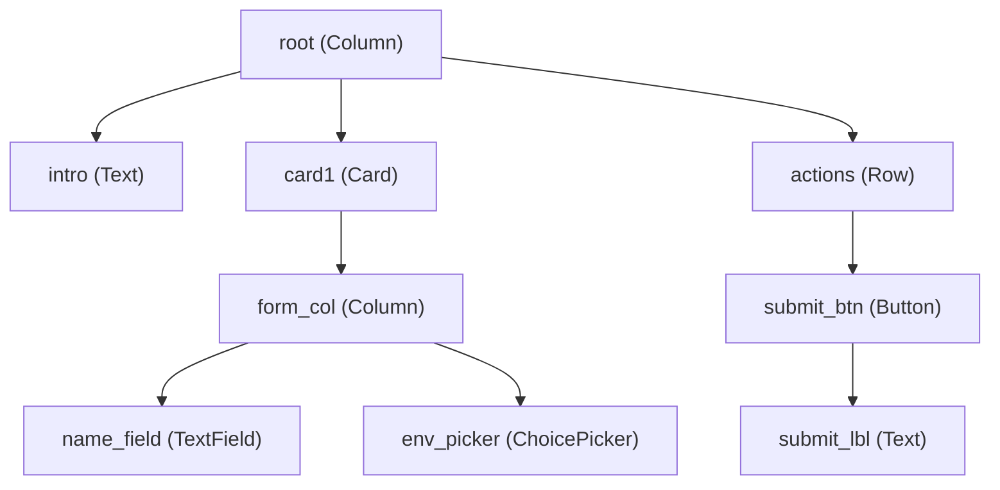

# A2UI Basic Catalog Reference

Seamus utilizes the **A2UI Basic Catalog (v1.0)** for describing declarative user interfaces in artifacts. The full component definition JSON schema is stored in `./resources/catalog.json`.

Artifact UI definitions reside in `/artifacts/<family>/<uuid>/body.json` as a flat JSON array of component objects matching the structure expected in A2UI `updateComponents` events.

---

## The Mandatory Root Component Rule

> [!IMPORTANT]
> **One component in `components` MUST have `"id": "root"`** (typically a `Column`, `Row`, or `Card`).
> 
> A2UI resolves and renders component trees starting from the component with `id="root"`. All other components in the flat array must be direct or indirect descendants of this root component (referenced by ID in `children: ["..."]` or `child: "..."`).
>
> If multiple widgets are emitted without an enclosing root container, or if `id` or `component` aliases are used, Seamus loosely normalizes the tree (synthesizing a root `Column`, auto-assigning IDs, and adapting aliases) and returns a detailed `Notice: Automatically normalized component tree:` log to you in the tool response.



---

## Component Reference

### 1. Root & Layout Containers

#### `Column`
Vertical stack layout container.
```json
{
  "id": "root",
  "component": "Column",
  "children": ["title_text", "settings_card", "actions_row"]
}
```
- `children`: Array of component IDs rendered vertically in order.
- `justify`: (Optional) `"start" | "center" | "end" | "spaceBetween" | "spaceAround" | "spaceEvenly"`
- `align`: (Optional) `"start" | "center" | "end" | "stretch" | "baseline"`

#### `Row`
Horizontal layout container.
```json
{
  "id": "actions_row",
  "component": "Row",
  "children": ["cancel_btn", "submit_btn"]
}
```
- `children`: Array of component IDs rendered horizontally in order.
- `justify`, `align`: Same options as `Column`.

#### `Card`
Visually framed panel card.
```json
{
  "id": "settings_card",
  "component": "Card",
  "child": "settings_column"
}
```
> [!CAUTION]
> In A2UI v1.0, `Card` strictly accepts a single child ID (`"child": "<id>"`). It **does NOT** accept `title` or `body`. To create a card with a title and multiple fields, point `child` to a `Column` containing a `Text` title and your content components.

#### `Divider`
Visual dividing line.
```json
{
  "id": "divider_1",
  "component": "Divider",
  "axis": "horizontal"
}
```
- `axis`: `"horizontal" | "vertical"` (defaults to `"horizontal"`).

#### `Tabs`
Tabbed container switching between multiple child subtrees.
```json
{
  "id": "settings_tabs",
  "component": "Tabs",
  "tabs": [
    { "title": "Overview", "child": "overview_col" },
    { "title": "Advanced", "child": "advanced_col" }
  ]
}
```
- `tabs`: Array of objects, each with `title` (string) and `child` (component ID).

#### `Modal`
Overlay dialog component.
```json
{
  "id": "confirm_modal",
  "component": "Modal",
  "trigger": "open_modal_btn",
  "content": "modal_content_card"
}
```
- `trigger`: Component ID of the clickable element that opens the modal (e.g., a button).
- `content`: Component ID of the content container displayed inside the modal.

#### `List`
Scrollable or repeating collection of child items.
```json
{
  "id": "items_list",
  "component": "List",
  "children": ["item_card_1", "item_card_2"],
  "direction": "vertical",
  "align": "stretch"
}
```
- `children`: Array of component IDs, or template binding object `{"path": "/items", "componentId": "template_id"}`.
- `direction`: `"vertical" | "horizontal"` (default: `"vertical"`).
- `align`: `"start" | "center" | "end" | "stretch"`.

---

### 2. Display Components

#### `Text`
Renders formatted text, markdown, or headings.
```json
{
  "id": "intro_title",
  "component": "Text",
  "text": "## Deployment Configuration",
  "variant": "body"
}
```
- `text`: String value (supports GitHub-flavored Markdown).
- `variant`: `"h1" | "h2" | "h3" | "h4" | "h5" | "body" | "caption"`

#### `Image`
Renders an image from a URL.
```json
{
  "id": "banner",
  "component": "Image",
  "url": "https://example.com/logo.png",
  "description": "App logo banner",
  "fit": "contain",
  "variant": "mediumFeature"
}
```
- `url`: Image source URL string (required).
- `description`: (Optional) Accessibility alt text.
- `fit`: (Optional) `"contain" | "cover" | "fill" | "none" | "scaleDown"` (default: `"fill"`).
- `variant`: (Optional) `"icon" | "avatar" | "smallFeature" | "mediumFeature" | "largeFeature" | "header"` (default: `"mediumFeature"`).

#### `Icon`
Renders a named icon.
```json
{
  "id": "check_icon",
  "component": "Icon",
  "name": "check"
}
```
- `name`: Name of the icon (e.g. `"check"`, `"info"`, `"warning"`).

#### `AudioPlayer`
Plays audio from a media URL.
```json
{
  "id": "audio_preview",
  "component": "AudioPlayer",
  "url": "https://example.com/audio.mp3",
  "description": "Audio commentary"
}
```
- `url`: Audio source URL string (required).
- `description`: (Optional) Description text.

#### `Video`
Plays video from a media URL.
```json
{
  "id": "video_demo",
  "component": "Video",
  "url": "https://example.com/demo.mp4"
}
```
- `url`: Video source URL string (required).

---

### 3. Input & Interactive Components

#### `TextField`
Text entry field for user input.
```json
{
  "id": "notes_input",
  "component": "TextField",
  "label": "Release Notes",
  "value": ""
}
```
- `label`: Label describing the field.
- `value`: Initial string value (or data model binding).
- `variant`: (Optional) `"shortText" | "longText" | "number" | "obscured"`

#### `ChoicePicker` (or `ChoiceSet`)
Single or multiple choice selection.
```json
{
  "id": "env_picker",
  "component": "ChoicePicker",
  "label": "Target Environment",
  "variant": "mutuallyExclusive",
  "options": [
    { "label": "Staging", "value": "staging" },
    { "label": "Production", "value": "production" }
  ],
  "value": ["staging"]
}
```
- `options`: List of `{ "label": str, "value": str }`.
- `variant`: `"mutuallyExclusive"` (radio buttons) or `"multipleSelection"` (checkboxes).
- `value`: List of selected value strings.

#### `CheckBox`
Boolean toggle input with a label.
```json
{
  "id": "agree_terms",
  "component": "CheckBox",
  "label": "I agree to the deployment conditions",
  "value": false
}
```
- `label`: Text label displayed next to the checkbox (required).
- `value`: Boolean state `true` or `false` (required).

#### `Slider`
Continuous or bounded numerical range input.
```json
{
  "id": "budget_slider",
  "component": "Slider",
  "label": "Budget Allocation ($k)",
  "min": 0,
  "max": 100,
  "value": 25
}
```
- `value`: Current numerical value (required).
- `max`: Maximum numerical value (required).
- `min`: (Optional) Minimum numerical value (default: 0).
- `label`: (Optional) Label string describing the slider.
> [!NOTE]
> Per the A2UI v1.0 Basic Catalog specification, `Slider` does not accept a `step` attribute.

#### `DateTimeInput`
Calendar date and/or clock time picker.
```json
{
  "id": "schedule_time",
  "component": "DateTimeInput",
  "label": "Scheduled Execution Time",
  "value": "2026-11-10T14:30:00Z",
  "enableDate": true,
  "enableTime": true
}
```
- `value`: Selected date/time string in ISO 8601 format (required; initialize with `""` if unset).
- `label`: (Optional) Text label for the input.
- `enableDate`: (Optional) Boolean allowing date selection (default: `false`).
- `enableTime`: (Optional) Boolean allowing time selection (default: `false`).
- `min`: (Optional) Minimum allowed date/time in ISO 8601 format.
- `max`: (Optional) Maximum allowed date/time in ISO 8601 format.

#### `Button`
Clickable action button.
```json
{
  "id": "deploy_btn",
  "component": "Button",
  "child": "deploy_btn_label",
  "variant": "primary",
  "action": {
    "event": {
      "name": "deploy_action",
      "context": {
        "tier": "production"
      }
    }
  }
}
```
- `id`: Button ID. **MUST be a valid UAX #31 identifier (letters, digits, underscores; no hyphens!)** and **MUST be declared in `manifest.json` under `buttons`**, or clicks will be ignored!
- `child`: String ID of a child component providing the label (typically a `Text` component).
- `variant`: `"primary"` (main action), `"default"` (secondary/neutral), `"borderless"` (link style).
- `action`: Action payload containing the event name (`event.name`) and optional static context (`event.context`).
> [!NOTE]
> Buttons do **NOT** require dynamic `{ "path": ... }` context pointers. Whenever a button is clicked, Seamus automatically captures a snapshot of all input widgets across the surface into `event.data`. Dynamic path pointers are disallowed and dropped. Buttons may declare static context flags (e.g. `{"approved": true}`) in `event.context`.

---

## Complete Example: Showcase Custom Artifact

Here is a complete, working example of an artifact showcasing widgets properly structured under a root container:

### `manifest.json`
```json
{
  "name": "Widget Showcase",
  "exposition": "embedded",
  "blocking": false,
  "commentable": false,
  "buttons": [
    {
      "id": "submit_btn",
      "clicks": 1,
      "unblocking": false,
      "closing": false
    }
  ]
}
```

### `body.json`
```json
[
  {
    "id": "root",
    "component": "Column",
    "children": ["header_text", "config_card", "actions_row"]
  },
  {
    "id": "header_text",
    "component": "Text",
    "text": "### Custom Widget Showcase\nConfigure your options below.",
    "variant": "body"
  },
  {
    "id": "config_card",
    "component": "Card",
    "child": "card_column"
  },
  {
    "id": "card_column",
    "component": "Column",
    "children": ["target_picker", "notes_field"]
  },
  {
    "id": "target_picker",
    "component": "ChoicePicker",
    "label": "Select Target",
    "variant": "mutuallyExclusive",
    "options": [
      { "label": "Development", "value": "dev" },
      { "label": "Staging", "value": "staging" }
    ],
    "value": ["dev"]
  },
  {
    "id": "notes_field",
    "component": "TextField",
    "label": "Additional Notes",
    "value": ""
  },
  {
    "id": "actions_row",
    "component": "Row",
    "children": ["submit_btn"]
  },
  {
    "id": "submit_btn",
    "component": "Button",
    "child": "submit_label",
    "variant": "primary",
    "action": {
      "event": {
        "name": "submit_showcase",
        "context": {
          "source": "showcase_form"
        }
      }
    }
  },
  {
    "id": "submit_label",
    "component": "Text",
    "text": "Submit Configuration"
  }
]
```
